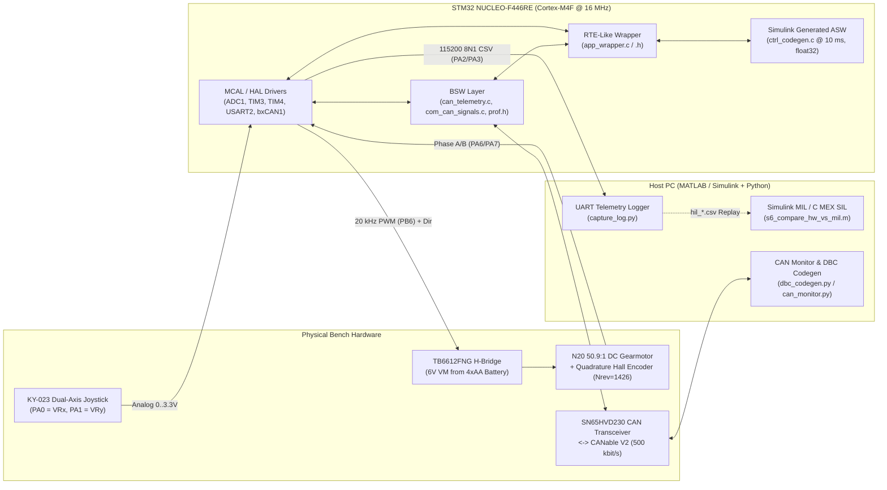
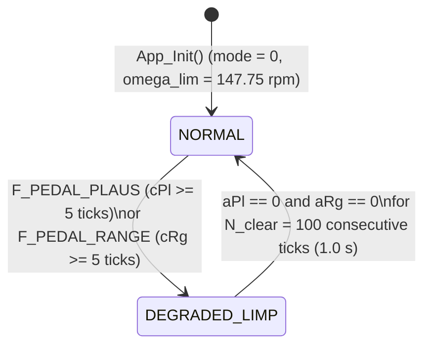
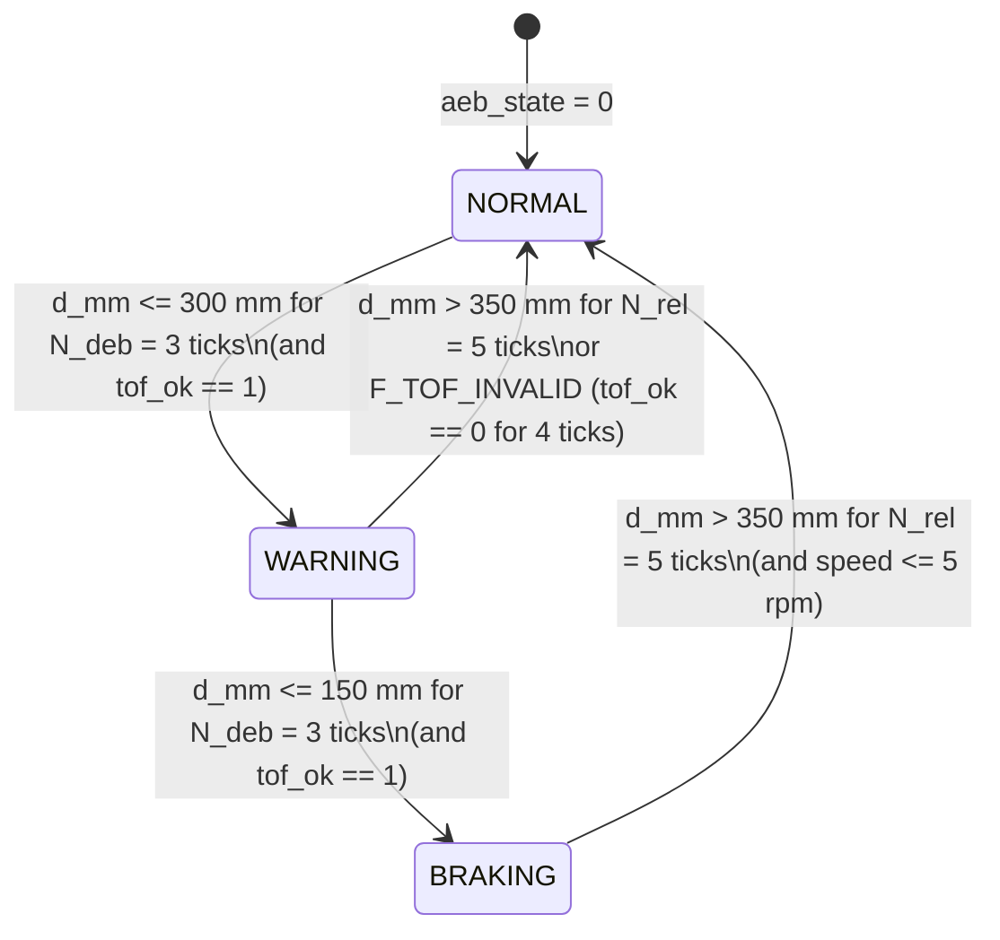

# 02 Architecture — System, Software & Hardware Architecture (Baseline v1.0)

This directory contains the system, software, and hardware architecture specifications for the **Mini Electronic Throttle + AEB ECU**.

| Document | Purpose |
| :--- | :--- |
| [`README.md`](README.md) | Master architecture reference: system context, verified STM32F446RE pin map, layered software architecture, signal dictionary, task schedule, and state machines |
| [`data_control_hardware_flow.md`](data_control_hardware_flow.md) | End-to-end physical-to-digital signal flow, 10 ms deterministic execution sequence, CAN data flow, and power/ground isolation |
| [`sandbox_simulation.md`](sandbox_simulation.md) | Pre-hardware engineering dry-run ("Paper HIL"), timing/bus load budgets, and scenario definitions (`S1`–`S6`) |

---

## 1. System Context & Hardware Topology

---

## 2. Verified STM32F446RE Pin Allocation

All pin assignments are verified on the physical `NUCLEO-F446RE` bench and match [`04_firmware/closed_loop_runner.c`](../04_firmware/closed_loop_runner.c):

| Signal | STM32 Pin | Arduino Header | Peripheral / Mode | Configuration Details |
| :--- | :---: | :---: | :--- | :--- |
| **Pedal Ch 1 (`VRx`)** | `PA0` | `A0` (`CN8-1`) | `ADC1_IN0` | 12-bit (`0..4095`), 84 cycles sample time |
| **Pedal Ch 2 (`VRy`)** | `PA1` | `A1` (`CN8-2`) | `ADC1_IN1` | 12-bit (`0..4095`), 84 cycles sample time |
| **Joystick Pushbutton (`SW`)** | `PA10` | `D2` (`CN9-3`) | `GPIO_Input` | Internal pull-up |
| **Encoder Phase A** | `PA6` | `D12` (`CN5-5`) | `TIM3_CH1` | `TIM_ENCODERMODE_TI12` (X4), pull-up, filter = 10 |
| **Encoder Phase B** | `PA7` | `D11` (`CN5-6`) | `TIM3_CH2` | `TIM_ENCODERMODE_TI12` (X4), pull-up, filter = 10 |
| **Motor PWM (`PWMA`)** | `PB6` | `D10` (`CN5-3`) | `TIM4_CH1` | 20 kHz (`PSC = 0, ARR = 799`), capped at `50.0 %` (`CCR <= 400`) |
| **Motor Dir 1 (`AIN1`)** | `PC7` | `D9` (`CN9-9`) | `GPIO_Output` | Push-pull (`HIGH` for forward rotation) |
| **Motor Dir 2 (`AIN2`)** | `PA9` | `D8` (`CN9-8`) | `GPIO_Output` | Push-pull (`LOW` for forward rotation) |
| **Motor Standby (`STBY`)** | `PA8` | `D7` (`CN9-1`) | `GPIO_Output` | Push-pull (`HIGH` = enabled, `LOW` = safe standby) |
| **Telemetry UART (`TX`/`RX`)** | `PA2` / `PA3` | ST-LINK VCP | `USART2` (`AF7`) | `115200` baud, `8N1`, non-blocking per-tick line stream |
| **CAN Bus (`CAN_RX`/`CAN_TX`)**| `PB8` / `PB9` | `D15` / `D14` | `CAN1` (`AF9`) | 500 kbit/s (`BRP = 2, TS1 = 13, TS2 = 2` at 16 MHz `PCLK1`) |
| **User Button (`B1`)** | `PC13` | Onboard | `GPIO_Input` | Starts autonomous step / live closed-loop test runs |
| **Status LED (`LD2`)** | `PA5` | `D13` (`CN5-6`) | `GPIO_Output` | Pre-flight & run-state indicator |

---

## 3. Layered Software Architecture & Schedule

### 3.1 Software Layers

| Layer | Files | Responsibility |
| :--- | :--- | :--- |
| **ASW (Application SWC)** | [`04_firmware/app_generated/ctrl_codegen.c`](../04_firmware/app_generated/ctrl_codegen.c), [`ctrl_codegen.h`](../04_firmware/app_generated/ctrl_codegen.h) | Pure single-precision (`real32_T`) 100 Hz control law generated by Embedded Coder from [`ctrl_codegen.slx`](../03_simulink/controller/ctrl_codegen.slx): `PedalCond`, `FaultMode`, `PedalLPF`, `PedalRateLim`, and discrete `SpeedPI` with dead-zone feedforward and back-calculation anti-windup |
| **RTE-Like Boundary** | [`04_firmware/app_wrapper.c`](../04_firmware/app_wrapper.c), [`app_wrapper.h`](../04_firmware/app_wrapper.h) | Translates `Rte_AppIn_t` and `Rte_AppOut_t` structs to/from Embedded Coder globals (`ctrl_codegen_U`, `ctrl_codegen_Y`, `ctrl_codegen_DW`) |
| **BSW (Com / E2E / Dem / UDS)** | [`04_firmware/bsw/com_can_signals.c`](../04_firmware/bsw/com_can_signals.c), [`can_telemetry.c`](../04_firmware/bsw/can_telemetry.c), [`prof.h`](../04_firmware/prof.h) | DBC-generated signal pack/unpack, SAE J1850 CRC-8 + 4-bit alive counter E2E protection, RX timeout monitoring (`can_age_ms`), latched fault memory (`stored_fault_bitmap`), UDS `0x22` responder, and `DWT->CYCCNT` WCET profiling |
| **MCAL / Hardware Runner** | [`04_firmware/closed_loop_runner.c`](../04_firmware/closed_loop_runner.c), `stm32f4xx_hal` | 10 ms tick synchronization, ADC1 channel polling, TIM3 encoder delta calculation, TIM4 PWM compare update with hard `50.0 %` duty clamp, and UART2 CSV streaming |

### 3.2 Deterministic 10 ms Task Schedule & Measured CPU Budget

| Sub-Task / Event | Period | Phase Offset | Measured Execution Time | CPU Load |
| :--- | :---: | :---: | :---: | :---: |
| **`App_Step10ms()` (ASW Control Step)** | `10 ms` (100 Hz) | `0` | **75–77 µs** (`DWT->CYCCNT`) | **0.77 %** (Limit $\le 20\text{ \%}$) |
| **CAN `0x200 Drive_Status` TX + E2E** | `20 ms` (50 Hz) | `tick % 2 == 0` | `< 15 µs` | `< 0.08 %` |
| **CAN `0x210 AEB_Status` TX + E2E** | `50 ms` (20 Hz) | `tick % 5 == 1` | `< 15 µs` | `< 0.03 %` |
| **CAN `0x201 Diag_Status` TX + E2E** | `100 ms` (10 Hz) | `tick % 10 == 3` | `< 15 µs` | `< 0.02 %` |
| **CAN `0x123 ECU_Heartbeat` TX** | `500 ms` (2 Hz) | `tick % 50 == 7` | `< 10 µs` | `< 0.01 %` |

---

## 4. State Machines

### 4.1 Fault & Mode Manager (`FaultMode` in `build_controller_subsystem.m`)

- **`NORMAL` (`mode = 0`):** Full speed request allowed ($\omega_{\max} = 147.75\text{ rpm}$).
- **`DEGRADED / LIMP` (`mode = 1`):** Speed request clamped to $\omega_{\text{limp}} = 30.0\text{ rpm}$ within `50 ms` (5 ticks). Any active fault resets the recovery counter `cClr = 0`; returning to `NORMAL` requires `100` consecutive fault-free ticks (`1.0 s`).

### 4.2 AEB State Machine (`aeb_ref.m`)

