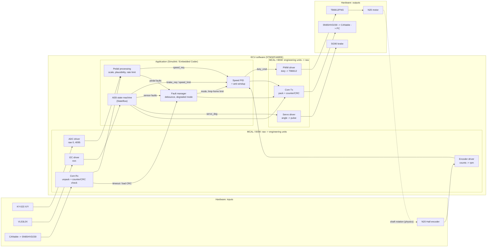
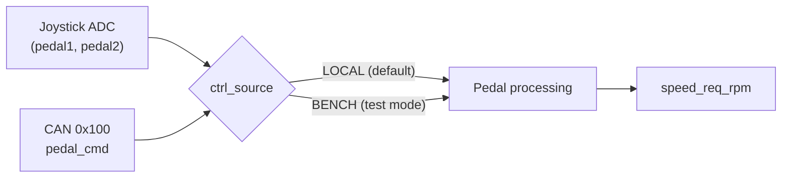
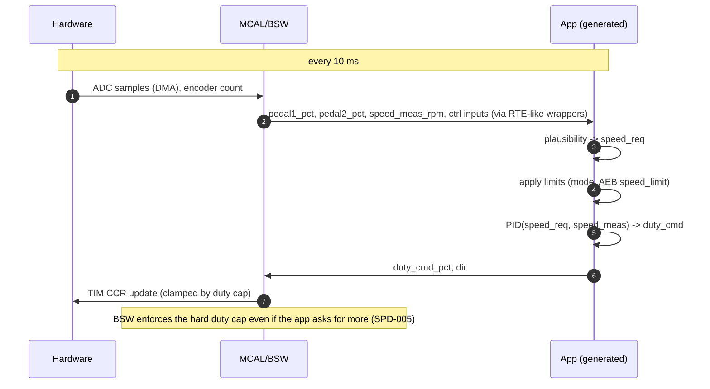
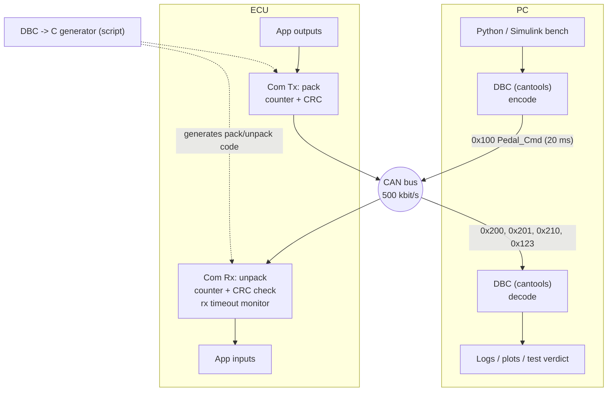
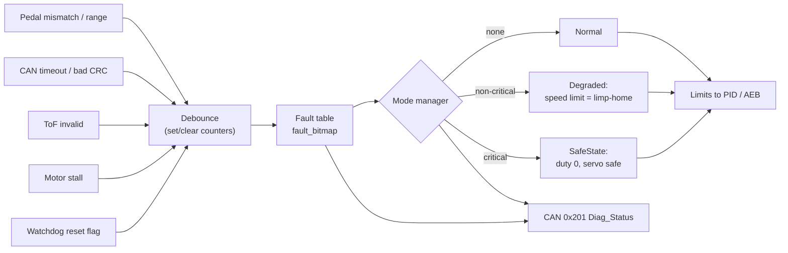
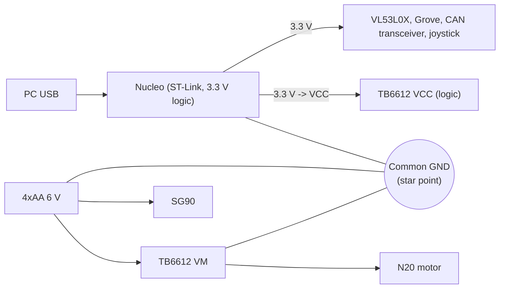
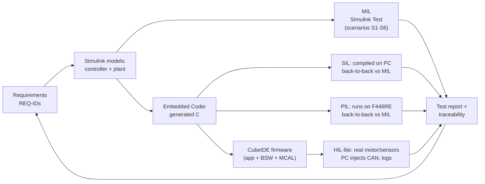

# Data · Control · Hardware Flow

How a physical quantity becomes a signal, passes through control logic, and returns as a physical action.
Companion to [`README.md`](README.md) and [`sandbox_simulation.md`](sandbox_simulation.md).

> [!NOTE]
> Reading guide: **Hardware** (physical) → **MCAL/BSW** (drivers, scaling) → **Application** (Simulink-generated logic) → back out to **Hardware**.

---

## 1. Big picture: closed loops across three layers

**Three closed loops**

| Loop | Path | Rate | Requirements |
| :--- | :--- | :---: | :--- |
| **L1 Speed control** | encoder → rpm → PID → duty → TB6612 → motor → encoder | 10 ms | SPD-001..005 |
| **L2 AEB** | VL53L0X → distance → state machine → speed limit + servo → (vehicle slows, distance changes) | 50 ms | AEB-001..006 |
| **L3 Supervision** | all fault sources → fault manager → mode → limits on L1/L2 + CAN report | 10–100 ms | DIA-*, SAF-* |

L1 runs fully on the ECU. The PC is **not** in any control loop; it is only a stimulus and logger (R8 in the sandbox).

---

## 2. Signal-by-signal flow

Follow one signal from the physical world to the output. `Unit` and `Rate` are drafts.

| # | Physical → raw | Driver | Signal in app | Used by | Output signal | Physical result | Rate |
| :-: | :--- | :--- | :--- | :--- | :--- | :--- | :---: |
| 1 | Joystick X angle → voltage 0–3.3 V | ADC1 CH0 (timer-triggered) | `pedal1_pct` | Pedal processing | `speed_req_rpm` | motor setpoint | 10 ms |
| 2 | Joystick Y angle → voltage | ADC2 CH1 | `pedal2_pct` (via PedalCond, REVERSE/HALF) | Plausibility check | `pedal_fault` | limp-home limit | 10 ms |
| 3 | Shaft rotation → Hall A/B pulses | TIM encoder mode | `speed_meas_rpm` | PID | `duty_cmd_pct` | PWM duty | 10 ms |
| 4 | Duty → PWM + IN1/IN2/STBY | TIM PWM + GPIO | — | TB6612 → motor | motor torque/speed | shaft speed | 10 ms |
| 5 | Target distance → ToF timing | I2C1 (VL53L0X) | `distance_mm` | AEB state machine | `aeb_state`, `speed_limit_rpm`, `servo_deg` | slow down + brake servo | 50 ms |
| 6 | PC frame `0x100` → CAN bits | bxCAN + FIFO0 | `pedal_cmd_pct` (alt. source) | Pedal processing | same as #1 | same | 20 ms |
| 7 | Faults → debounced flags | (software) | `fault_bitmap`, `mode` | PID limit, CAN report | `0x201` Diag_Status | PC sees faults | 100 ms |
| 8 | Status → CAN frames | bxCAN TX | `speed_meas_rpm`, `duty`, `mode`, `distance`, `aeb_state` | PC / ESP32 | `0x200`, `0x210` | logs, dashboard | 20/50 ms |

### Pedal source arbitration (draft rule)

Both sources go through the same plausibility and limiting logic. This lets the PC run **HIL-lite** tests by injecting a pedal profile via CAN without touching the joystick. Select the source with a calibration flag or a CAN command (**TBD**).

---

## 3. Control data path (the 10 ms tick, in order)

**Design rules this encodes**
- The application never touches registers or HAL. It only reads/writes signals through RTE-like wrappers.
- Scaling to engineering units happens in BSW; limits that protect hardware (duty cap, servo angle limits) live in BSW as the last barrier.
- Order inside a tick is fixed: **read → process → decide → write**, so the data is consistent in one cycle.

---

## 4. Communication data flow (CAN)

**One source of truth:** `05_can/vehicle.dbc` is used by (a) the PC scripts (cantools), (b) the C code generator for BSW Com, and (c) the test cases. If a signal changes, change the DBC first.

---

## 5. Fault and mode flow

| Fault | Reaction | Mode | Safety goal |
| :--- | :--- | :---: | :---: |
| Pedal mismatch | speed limit = limp-home | Degraded | SG-01 |
| CAN timeout | substitute pedal (0) | Degraded | SG-01 |
| ToF invalid | no braking from that data, warn | Degraded | SG-03 |
| Motor stall | reduce duty | Degraded/Safe | SG-02 |
| Watchdog reset | start in safe outputs, report reset cause | Init → Normal | SG-02 |

---

## 6. Power and ground flow (physical)

Rules: motor and servo power come **only** from the battery. Logic is powered from the Nucleo (USB). Only GND is shared. Add a bulk capacitor near the driver and a 100 nF capacitor across the motor terminals (R1/R2 in the sandbox).

---

## 7. Development data flow (MBD V-model)

How the same model becomes tests at each level (MIL → SIL → PIL → HIL-lite).

| Level | What is real | What is simulated | Signals compared |
| :--- | :--- | :--- | :--- |
| MIL | nothing | controller + plant in Simulink | reference |
| SIL | generated code (PC) | plant in Simulink | duty, state vs MIL |
| PIL | generated code on STM32 | plant in Simulink | duty, state vs MIL, execution time |
| HIL-lite | ECU + N20 + sensors | environment (PC stimulus, CAN) | speed, CAN signals, faults vs requirements |

---

## 8. Quick reference: where is each concern handled?

| Concern | Layer | Where |
| :--- | :--- | :--- |
| ADC scaling, encoder → rpm, ToF read | MCAL/BSW | `04_firmware/mcal/`, `bsw/` |
| Pedal logic, PID, AEB, fault logic | Application | `03_simulink/controller/` |
| Hard limits (duty cap, servo angle) | BSW | `04_firmware/bsw/` |
| Signal pack/unpack, CAN timeout | BSW Com | generated from `05_can/vehicle.dbc` |
| Plant physics | Simulink (MIL) / real hardware (HIL) | `03_simulink/plant/` |
| Stimulus, fault injection, logging | PC | `06_test/hil/` |
