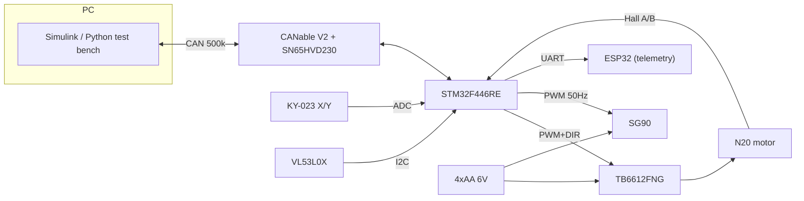
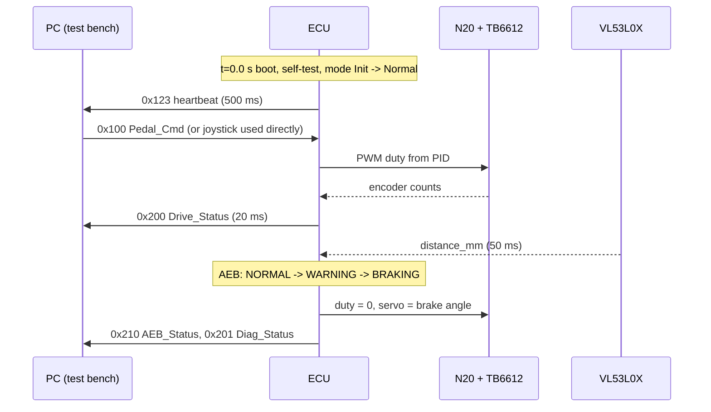

# Sandbox Simulation — "Paper HIL" of the Combined Hardware

> [!NOTE]
> This is a **desk-based dry run**: a walk-through of what the integrated system should do, tick by tick, using the
> hardware in `Lab_Hardware/list.md`. Every number marked *(assumed)* is an **illustrative guess** to be replaced by
> measurements in Phase 2. Nothing here has been run on hardware. Use it to find integration problems
> *before* wiring, and later as a reference for MIL/HIL test vectors.

## 1. Sandbox cast

| Role | Hardware | Interface (draft, verify against pin map) | Signals |
| :--- | :--- | :--- | :--- |
| ECU | STM32 NUCLEO-F446RE (HSI 16 MHz) | — | runs generated app + BSW |
| Pedal ×2 | KY-023 joystick (X, Y) | 2 × ADC (e.g. PA0, PA1) | `pedal1_raw`, `pedal2_raw` (0–4095) |
| Plant | GA12-N20 + Hall encoder | TIM encoder mode (e.g. PA6/PA7) | `speed_rpm` |
| Driver | TB6612FNG | PWM (TIM, ~20 kHz) + 2 GPIO (IN1/IN2) + STBY | `duty_pct`, `dir` |
| Brake actuator | SG90 | PWM 50 Hz (1–2 ms pulse) | `servo_deg` |
| ADAS sensor | VL53L0X | I2C1 (e.g. PB8/PB9) | `distance_mm` |
| IMU (optional) | MMA7660FC | same I2C1 (different address) | `accel_x/y/z` |
| Cabin (optional) | Grove temp | ADC | `cabin_temp_c` |
| Network | SN65HVD230 + CANable V2 | CAN1 PA11/PA12 | DBC messages (`05_can/`) |
| Telemetry | ESP32 | UART (read-only) | forwarded CAN signals |
| Power | 4×AA (≈6 V) | motor + servo only | isolated from logic, common GND |
| "Test bench" | PC: Simulink + Python | USB (ST-Link VCP + CANable) | stimulus, logging, fault injection |

## 2. Sanity budget (do these before anything else)

### 2.1 Voltage / duty limit
The N20 is rated **3 V**; the supply is **≈6 V** (4×AA alkaline, fresh).

$$D_{max} = \frac{V_{motor,rated}}{V_{supply}} = \frac{3}{6} = 50\,\%$$

→ Cap the PWM duty at about **50 %** (SPD-005). With NiMH cells (≈4.8 V) the cap would be about 62 %. **Measure the real battery voltage under load** and make the cap a calibration, not a constant. This also defines your maximum speed: at the cap, expect about the rated no-load speed (e.g. ~150 rpm output shaft *(assumed, check the motor label)*).

### 2.2 Encoder resolution *(assumed, check datasheet)*
Typical N20 Hall encoder: 7 pulses/rev on the motor shaft, gear ratio 1:150, quadrature ×4:

$$N_{rev} = 7 \times 4 \times 150 = 4200\ \text{counts / output rev}$$

At 90 rpm output (1.5 rev/s): 6300 counts/s → **63 counts per 10 ms** control tick. Resolution is about 1.6 % per count at 90 rpm, so a 10 ms speed sample is noisy. Plan a 20–50 ms speed window or a filter (this feeds SPD-001 and SPD-003).

### 2.3 CAN load
Frame ≈ 100–110 bits with stuffing (8 data bytes) at 500 kbit/s ≈ 0.2 ms.

| Message | Cycle | Frames/s |
| :--- | :---: | :---: |
| Pedal_Cmd | 20 ms | 50 |
| Drive_Status | 20 ms | 50 |
| Diag_Status | 100 ms | 10 |
| AEB_Status | 50 ms | 20 |
| Heartbeat | 500 ms | 2 |
| **Total** | | **132** |

Load ≈ 132 × 0.22 ms ≈ 29 ms per s ≈ **~3 %**. Plenty of margin.

### 2.4 Task schedule (draft)

| Task | Period | Content | Budget (assumed) |
| :--- | :---: | :--- | :---: |
| `Task_1ms` | 1 ms | ADC trigger, watchdog service check | < 50 µs |
| `Task_10ms` | 10 ms | pedal processing, PID, PWM update | < 1 ms |
| `Task_20ms` | 20 ms | CAN TX/RX, timeout monitor | < 0.5 ms |
| `Task_50ms` | 50 ms | VL53L0X read, AEB state machine | < 3 ms (I2C 400 kHz) |
| `Task_100ms` | 100 ms | diagnostics, telemetry | < 1 ms |

At 16 MHz the CPU is slow-ish for floating-point PID + I2C. Check **PRC-003** early. The F446 has an FPU, but the 180 MHz PLL is a fallback if needed (CAN bit timing then has to be recalculated).

## 3. Scenario script

State at start: motor stopped, servo at 0° (brake released), ECU mode `Init`.

### S1 — Nominal throttle step (THR-002, SPD-002, SPD-003)

| t (s) | Event | Pedal % | Speed request (rpm) | Duty (%) | Speed (rpm) *(illustrative)* | Mode |
| ---: | :--- | ---: | ---: | ---: | ---: | :---: |
| 0.0 | Boot, outputs safe (SAF-002) | 0 | 0 | 0 | 0 | Init |
| 0.5 | Self-test OK | 0 | 0 | 0 | 0 | Normal |
| 1.0 | Pedal step to 60 % | 60 | 90 | 50 (saturated, initial) | 0 | Normal |
| 1.1 | PID drives up | 60 | 90 | ~48 | 44 | Normal |
| 1.2 | | 60 | 90 | ~44 | 66 | Normal |
| 1.3 | Approaching target | 60 | 90 | ~40 | 78 | Normal |
| 1.5 | | 60 | 90 | ~38 | 87 | Normal |
| 1.6+ | Steady (±2 %) | 60 | 90 | ~38 | 90 | Normal |

Assumed closed loop is first order, τ ≈ 0.15 s ⇒ speed ≈ 90·(1 − e^(−t/0.15)).
**What to check:** the duty is saturated at the cap at the start, so anti-windup (SPD-004) matters — without it, expect overshoot after the cap releases. Compare MIL with PIL/HIL at the same pedal profile.

### S2 — AEB approach (AEB-002/003/004), tabletop "car"
A card moves toward the VL53L0X. Thresholds *(assumed)*: warn 300 mm, brake 150 mm, hysteresis 50 mm.

| t (s) | Distance (mm) | AEB state | Speed request | Servo (°) | CAN |
| ---: | ---: | :---: | ---: | ---: | :--- |
| 0.00 | 600 | NORMAL | pedal | 0 | `0x210` dist=600 st=0 |
| 0.50 | 400 | NORMAL | pedal | 0 | |
| 0.90 | 290 | **WARNING** | pedal | 0 | `0x210` st=1 |
| 1.20 | 190 | WARNING | pedal | 0 | |
| 1.40 | 140 | **BRAKING** | **0** | **brake [TBD, e.g. 60]** | `0x210` st=2 |
| 1.40 | | | | | duty ramps to 0, speed → 0 |
| 3.00 | 350 | BRAKING → (hold) | 0 | 60 | needs `distance > 200 mm` for the hold time |
| 3.50 | 360 | **NORMAL** | pedal | 0 | `0x210` st=0 |

**What to check:** the VL53L0X range is limited (~1.2 m indoors), the target colour matters, and its update rate depends on the timing budget (20–33 ms typical). The hysteresis must be wider than the sensor noise. **Measure σ of the distance at fixed positions** (feeds AEB-004).

### S3 — Pedal plausibility fault (THR-003/004, DIA-002, SAF-003)
Both channels normally track. Simulate: channel 2 disconnected (floating / stuck at mid-scale).

| t (ms) | pedal1 % | pedal2 % | Δ | Debounce counter | Fault | Speed request |
| ---: | ---: | ---: | ---: | ---: | :---: | :--- |
| 0 | 60 | 60 | 0 | 0 | none | 90 |
| 10 | 60 | 5 | 55 | 1 | none | 90 |
| 30 | 60 | 5 | 55 | 3 | none | 90 |
| 50 | 60 | 5 | 55 | 5 (threshold) | **ACTIVE** | **limp-home [TBD, e.g. 30 rpm]** |
| 60 | 60 | 5 | 55 | | `Diag_Status` bit set, mode **Degraded** | 30 |
| later | 60 | 60 | 0 | clear counter | cleared after hold time | back to 90, mode Normal |

Debounce: ΔT 10 ms, threshold 5 ticks ⇒ 50 ms *(assumed)*. **FTTI** (HARA) must be longer than detection + reaction.
**Watch out:** a floating ADC input does not read 0; it drifts. Test "open wire" with a pull-down/up strategy (THR-005).

### S4 — CAN command loss (CAN-006)
PC sends `Pedal_Cmd` every 20 ms. Timeout = 3 × 20 = **60 ms**.

| t (ms) | Event | Rx age (ms) | State |
| ---: | :--- | ---: | :--- |
| 0 | Last valid `0x100` | 0 | OK |
| 20 | Missing | 20 | OK |
| 40 | Missing | 40 | OK |
| 60 | Missing | 60 | **timeout fault** → substitute pedal = 0 (DBC) |
| 70 | `Diag_Status` shows CAN-timeout bit | 70 | Degraded |
| 500 | PC resumes | 0 | recovery after debounce (e.g. 5 valid frames) |

Variation: send frames with a **wrong counter or CRC** → frames discarded, `rx_error_count`++ (CAN-005), timeout triggers if the bad frames continue.

### S5 — Motor stall (SPD-006)
Hold the shaft. Request 90 rpm, measured 0.

| t (s) | Duty | Speed | Error | Result |
| ---: | ---: | ---: | ---: | :--- |
| 0.0 | 50 (cap) | 0 | 90 | integrator starts (anti-windup active) |
| 1.0 | 50 | 0 | 90 | tracking-fault timer running |
| 2.0 | 50 | 0 | 90 | **speed-tracking fault** → duty reduced to protect the motor |

**Why it matters:** a stalled N20 at 3 V draws maybe several hundred mA *(assumed, measure)*. Don't keep full duty on a stalled motor — the TB6612FNG is rated ~1.2 A continuous, but a tiny motor overheats.

### S6 — Watchdog (SAF-001/002)
Debug build deliberately stops the 10 ms task. After the timeout the IWDG resets the MCU. On restart:

1. Reset cause read (IWDG flag) → `Diag_Status` reports it.
2. PWM = 0, servo to the safe angle, mode `Init` → `Normal` only after self-test.
3. The PC sees the heartbeat counter restart from 0 → easy to detect in the logs.

## 4. Integration risks found by the dry run

| # | Risk | Why | Mitigation | Related |
| :-: | :--- | :--- | :--- | :--- |
| R1 | **Motor noise** on ADC (pedal, temp) and I2C | PWM + brushed motor generates EMI | Common-GND star point, 100 nF across motor terminals, twisted motor wires, sample ADC away from PWM edges (timer-triggered), software filter | THR-001, AEB-005 |
| R2 | **Brownout** when servo + motor start | Both share 4×AA | Bulk capacitor (≥470 µF) near the driver, never power the logic from the AA pack, watch battery voltage | SAF-005 |
| R3 | **Servo jitter / buzz** | SG90 under load, timer shared with another PWM | Dedicated timer channel, power from battery not from Nucleo 5 V, cap the angle to avoid hitting the stop | AEB-003 |
| R4 | **Timer resource conflicts** | Encoder, motor PWM, servo PWM, ADC trigger, scheduler | Allocate timers in `pin_map.md` up front (e.g. TIM3 encoder, TIM1 motor PWM, TIM2 servo, TIM6 scheduler) | all |
| R5 | **I2C bus lockup** (VL53L0X) | Noise or reset mid-transfer | Timeout on every transfer, bus-recovery (9 clock pulses), sensor-invalid fault | AEB-005 |
| R6 | **Voltage levels** | Grove modules are 3.3–5 V; the temp sensor output scales with VCC | Power Grove parts from 3.3 V, check ADC range, never feed 5 V to a Nucleo pin | THR-001 |
| R7 | **CAN: single node = TX errors** | No ACK without a second node | Always keep the CANable online and logging; test with termination check (≈60 Ω) | CAN-001 |
| R8 | **HIL-lite latency** | PC ↔ ECU over USB/CAN is not real-time | Keep closed-loop control on the ECU; use PC only for stimulus and logging; record the timestamp jitter | PRC-002 |
| R9 | **Clock accuracy** | HSI ≈ ±1 % | OK at 500 kbit/s on the bench; revisit with PLL/HSE if CAN errors appear | CAN-001 |
| R10 | **Floating-point cost at 16 MHz** | Generated float code | Use single precision, measure step time, raise clock if needed | PRC-003 |
| R11 | **Joystick not like a pedal** | KY-023 axes are *not* two redundant sensors; it is a mid-centred 2-axis pot | Map each axis as a one-sided pedal (e.g. up from centre) or add a dedicated pot; document the "pedal emulation" | THR-001..003 |

## 5. Measurements to take (feed the [TBD] values)

| # | Measure | Method | Fills |
| :-: | :--- | :--- | :--- |
| M1 | Motor no-load speed vs duty (open loop, 0–50 % in 10 % steps) | log encoder at fixed duty | SPD-005, plant gain |
| M2 | Step response 0 → 30 % duty | log encoder at 1 kHz via UART/CAN | SPD-007, plant τ |
| M3 | Static friction / dead zone | slowly increase duty until it starts | plant model |
| M4 | Battery voltage with and without load | multimeter | duty cap |
| M5 | Stall current (short, ≤1 s) | multimeter in series | SPD-006 |
| M6 | Encoder counts per output rev | rotate shaft one turn by hand | resolution, SPD-001 |
| M7 | Joystick min / centre / max, noise | log ADC | THR-002, THR-003 |
| M8 | VL53L0X noise and range per surface | fixed distances 100–500 mm | AEB thresholds |
| M9 | Task execution times | DWT cycle counter | PRC-003, SAF-004 |
| M10 | CANH–CANL resistance and bus error counters | multimeter, candump | CAN-001 |

## 6. How to use this document later

1. Turn each scenario S1–S6 into a **test vector** for Simulink Test (MIL) → same vectors for PIL → HIL-lite.
2. Replace *(assumed)* numbers with M1–M10 results and note it in `01_requirements/change_log.md`.
3. If a scenario fails in MIL, fix the model before touching hardware. That is the point of the V-model.
4. Add new scenarios (e.g. battery sag, I2C lock-up) as risks R1–R11 become tests.
