# 08 Results & Media — Real Hardware Execution Logs, Bench Photos & Videos

This directory stores the **physical bench execution evidence** captured from the **STM32F446RE (`NUCLEO-F446RE`)** + **N20 50:1 DC Gearmotor + Quadrature Hall Encoder** + **KY-023 Dual-Axis Analog Pedal Emulator** + **SN65HVD230 / CANable V2** + **SG90 Brake Servo** + **TOF53200 (VL53L0X)** test bench.

All photos and videos have been **stripped of EXIF/camera/location metadata** and encoded in web-standard formats (**JPEG** and **H.264 / AAC MP4** with `yuv420p` + `faststart`) for direct viewing in GitHub's web UI.

> [!TIP]
> For the MATLAB-generated verification plots (`validation.png`, `plant_validation.png`, `hw_vs_mil_hil_step_test.png`, `hw_vs_mil_hil_closed_loop.png`) and the Stage 4 SIL back-to-back report (`b2b_report.md`), see [`06_test/reports/`](../06_test/reports/) and [`03_simulink/data/real/`](../03_simulink/data/real/).

---

## 1. Directory Layout

```text
08_results/
├── README.md                                      # Gallery & index of hardware logs, bench photos & videos
├── logs/                                          # Raw terminal transcripts from real STM32 hardware sessions
│   ├── joystick_motor_calibration_log.txt         # Stage 2: 4 joystick calibration runs + 19 motor static/step sweeps
│   ├── closed_loop_live_log.txt                   # Stage 6: Closed-loop 6 s auto-step (75 µs WCET) & 15 s live joystick (77 µs WCET)
│   └── can_fault_capture_log.txt                  # Stage 5/6: Live CANable 500 kbit/s slcan trace + UDS 0x22 fault & WCET readout
├── photos/                                        # Metadata-stripped hardware bench & wiring photographs (12 files)
└── videos/                                        # Metadata-stripped H.264 MP4 demonstration videos (5 files)
```

---

## 2. Real Hardware Terminal Logs (`logs/`)

| Log File | V-Model Stage | Interface | What It Records |
| :--- | :---: | :---: | :--- |
| **[`joystick_motor_calibration_log.txt`](logs/joystick_motor_calibration_log.txt)** | **Stage 2: System ID** | `USART2` (`115200` baud) via [`capture_log.py`](../04_firmware/experiments/capture_log.py) | Complete on-target capture session recording all **23 real-hardware identification datasets** into [`03_simulink/data/real/`](../03_simulink/data/real/):<br>• 4 dual-channel pedal sessions (`joy_rest.csv`, `joy_diag_full.csv`, `joy_diag_valid.csv`, `joy_xonly.csv`)<br>• 10 static duty-sweep runs (`static_D05.csv` … `static_D50.csv`, 271 rows each)<br>• 9 dynamic step-response runs (`step_15_r1..r3`, `step_25_r1..r3`, `step_35_r1..r3`, 351 rows each) |
| **[`closed_loop_live_log.txt`](logs/closed_loop_live_log.txt)** | **Stage 6: Closed-Loop HIL** | `USART2` (`115200` baud) via [`closed_loop_runner.c`](../04_firmware/closed_loop_runner.c) | Real-time 100 Hz closed-loop execution of Embedded Coder generated [`ctrl_codegen_step()`](../04_firmware/app_generated/ctrl_codegen.c) on the STM32F446RE:<br>• `hil_step_test.csv` (601 rows, 6.0 s autonomous 60 % step test, max WCET = **`75 µs`**, **96.1 %** NRMSE fit vs. Simulink MIL)<br>• `hil_closed_loop.csv` (1,501 rows, 15.0 s live joystick driving + single-axis `F_PEDAL_PLAUS` fault injection + `30 rpm` limp-home clamp + 1.0 s auto-recovery, max WCET = **`77 µs`**, **96.6 %** NRMSE fit vs. Simulink MIL) |
| **[`can_fault_capture_log.txt`](logs/can_fault_capture_log.txt)** | **Stage 5 & 6: CAN BSW & UDS Diagnostics** | `bxCAN1` (`500 kbit/s`) ↔ `CANable V2` via [`can_monitor.py`](../05_can/can_monitor.py) | Live 500 kbit/s CAN 2.0A bus trace verifying:<br>• Cyclic `0x200 Drive_Status` reception with valid SAE J1850 CRC-8 (`CRC:OK`) and rolling 4-bit `msg_counter`<br>• Automatic transition from `mode=NORMAL` to `mode=DEGRADED` (`req = 30.0 rpm` limp-home clamp) upon pedal fault injection<br>• Event-driven `0x201 Diag_Status` fault detection (`fault_bitmap = 0x0002`) triggering a live **UDS `0x22 ReadDataByIdentifier`** request (`0x7E0`) and ECU response (`0x7E8`) returning `DID 0xF100 (Active Faults) = 0x0002` and `DID 0xF102 (Max Step WCET) = 75 us` |

---

## 3. Demonstration Videos (`videos/`)

Click any video link below to play directly in GitHub's web video player (H.264 / AAC, 720p, 30 fps, faststart):

| Video | Stage / Lab | Description |
| :--- | :---: | :--- |
| **[`01_smoketest_motor_spin_demo.mp4`](videos/01_smoketest_motor_spin_demo.mp4)** | Stage 0 (`00_smoketest/motor`) | N20 50:1 DC gearmotor + TB6612FNG PWM spin & Hall encoder bring-up |
| **[`02_smoketest_sg90_servo_sweep_demo.mp4`](videos/02_smoketest_sg90_servo_sweep_demo.mp4)** | Stage 0 (`00_smoketest/servo`) | SG90 micro servo AEB brake actuator sweep verification |
| **[`03_stage2_motor_calibration_capture.mp4`](videos/03_stage2_motor_calibration_capture.mp4)** | Stage 2 (`s2_01` / `s2_02`) | Automated on-target motor static & step-response sweep logged to CSV via UART |
| **[`04_stage6_hil_auto_step_test.mp4`](videos/04_stage6_hil_auto_step_test.mp4)** | Stage 6 (`ClosedLoop_RunAutoStep`) | Real-time 100 Hz closed-loop autonomous 60 % step test on STM32F446RE |
| **[`05_stage6_hil_live_joystick_fault_injection.mp4`](videos/05_stage6_hil_live_joystick_fault_injection.mp4)** | Stage 6 (`ClosedLoop_RunLive`) | Live joystick closed-loop speed control + single-axis `F_PEDAL_PLAUS` fault injection (`30 rpm` limp-home) |

---

## 4. Hardware Bench Photographs (`photos/`)

### Stage 6 — Closed-Loop HIL & CAN Bus Bench
| Full HIL + CAN System Bench | CANable V2.0 + SN65HVD230 Transceiver | Powered N20 Motor + Hall Encoder |
| :---: | :---: | :---: |
| 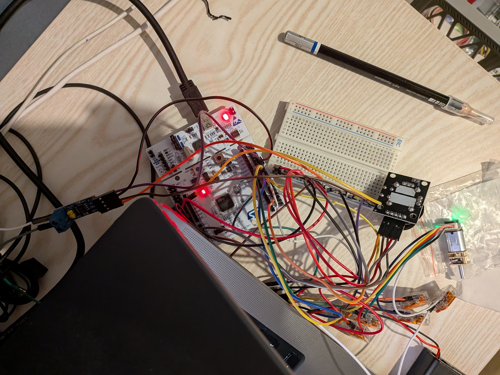 | 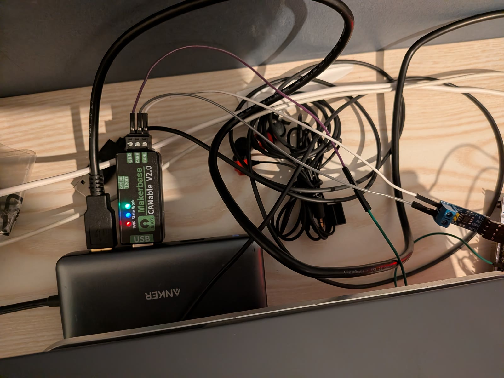 | 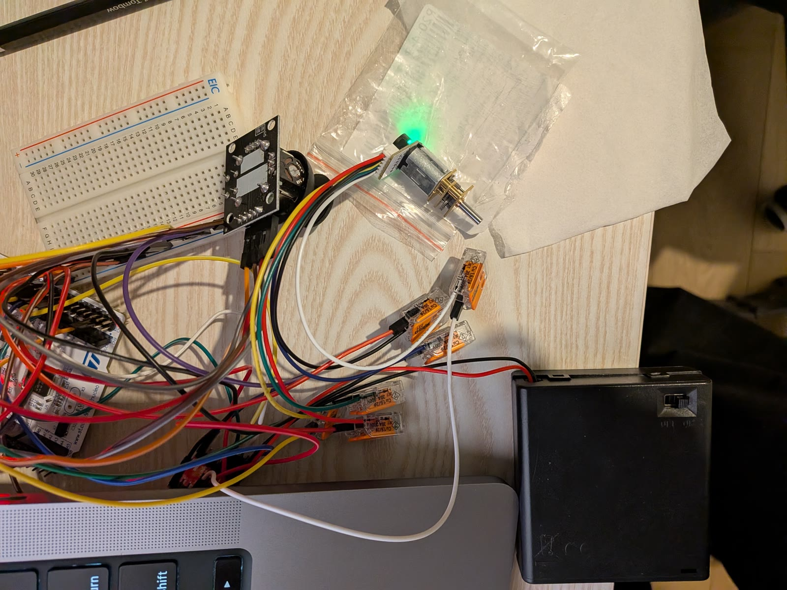 |
| [`11_hil_full_system_can_bench.jpg`](photos/11_hil_full_system_can_bench.jpg) | [`10_can_canable_sn65hvd230_wiring.jpg`](photos/10_can_canable_sn65hvd230_wiring.jpg) | [`12_hil_motor_encoder_wago_closeup.jpg`](photos/12_hil_motor_encoder_wago_closeup.jpg) |

| Closed-Loop Bench Wiring |
| :---: |
| 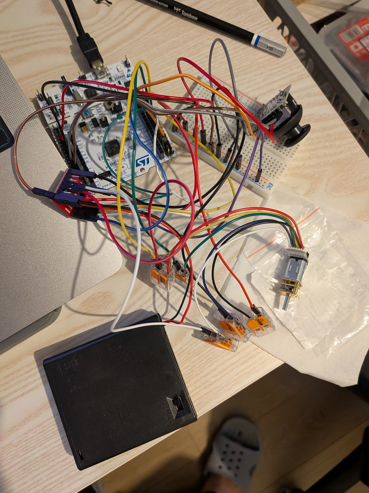 |
| [`09_hil_closed_loop_bench_wiring.jpg`](photos/09_hil_closed_loop_bench_wiring.jpg) |

### Stage 0 — Peripheral Bring-Up & Smoke Tests
| KY-023 Joystick Wiring | KY-023 Manual ADC Test | N20 + TB6612FNG + 6V Battery |
| :---: | :---: | :---: |
| 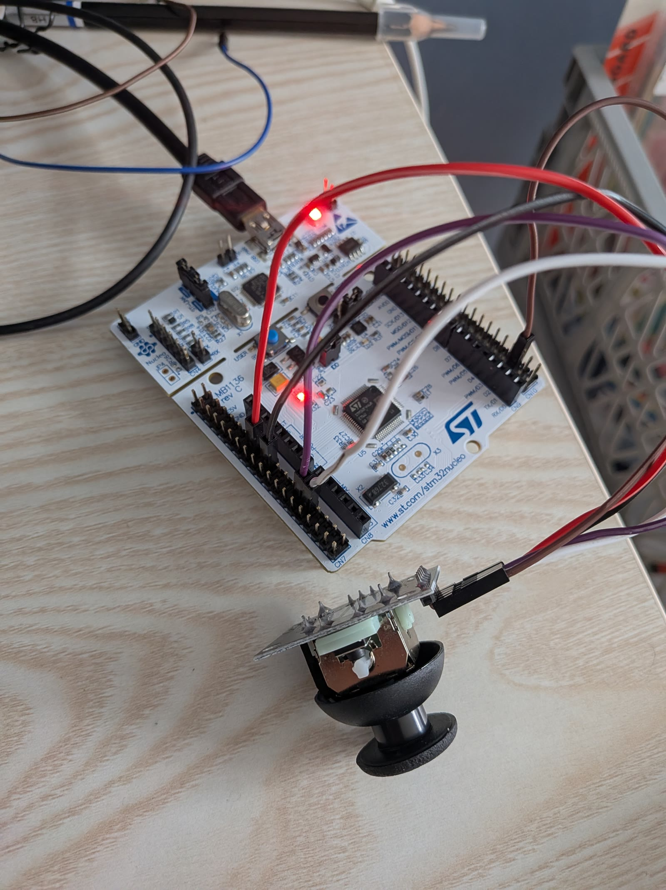 | 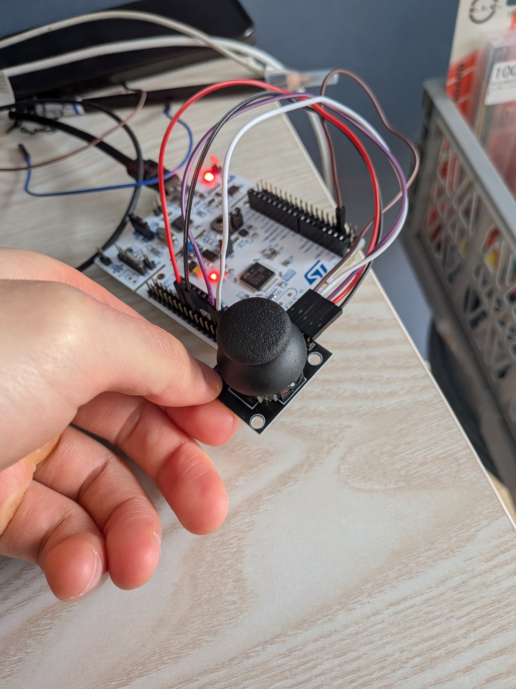 | 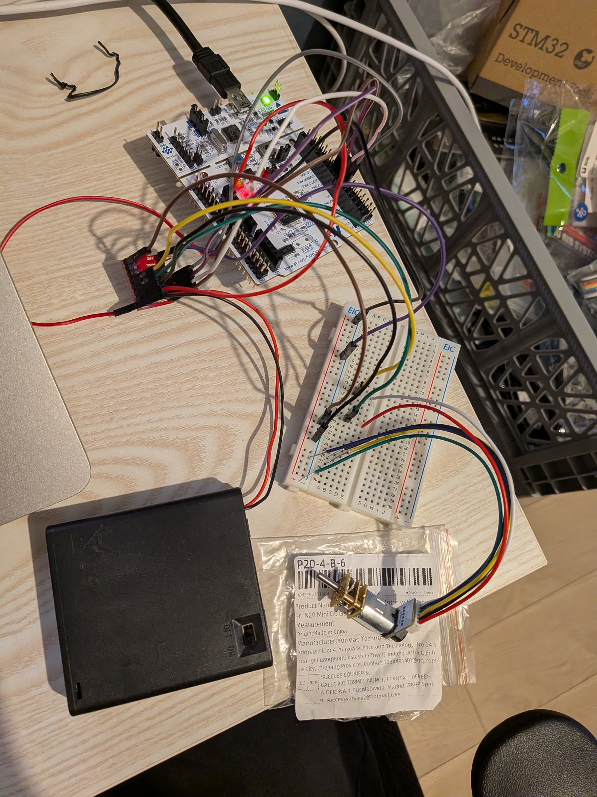 |
| [`01_smoketest_joystick_wiring.jpg`](photos/01_smoketest_joystick_wiring.jpg) | [`02_smoketest_joystick_test.jpg`](photos/02_smoketest_joystick_test.jpg) | [`03_smoketest_motor_tb6612_wiring.jpg`](photos/03_smoketest_motor_tb6612_wiring.jpg) |

| ToF Range Test | ToF I2C Nucleo Wiring | TOF53200 Sensor Close-Up |
| :---: | :---: | :---: |
| 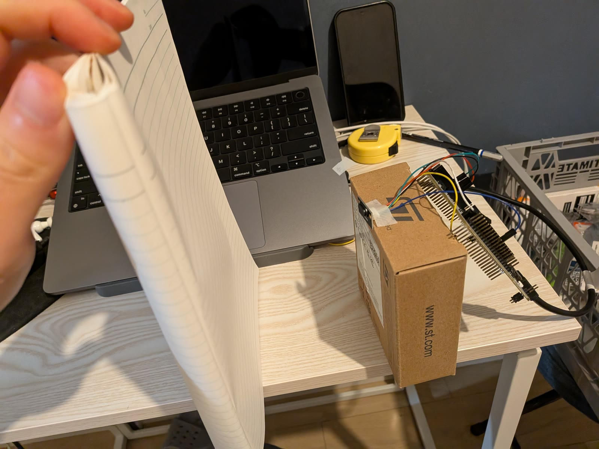 | 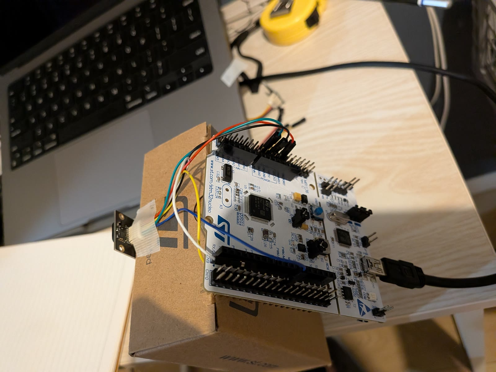 | 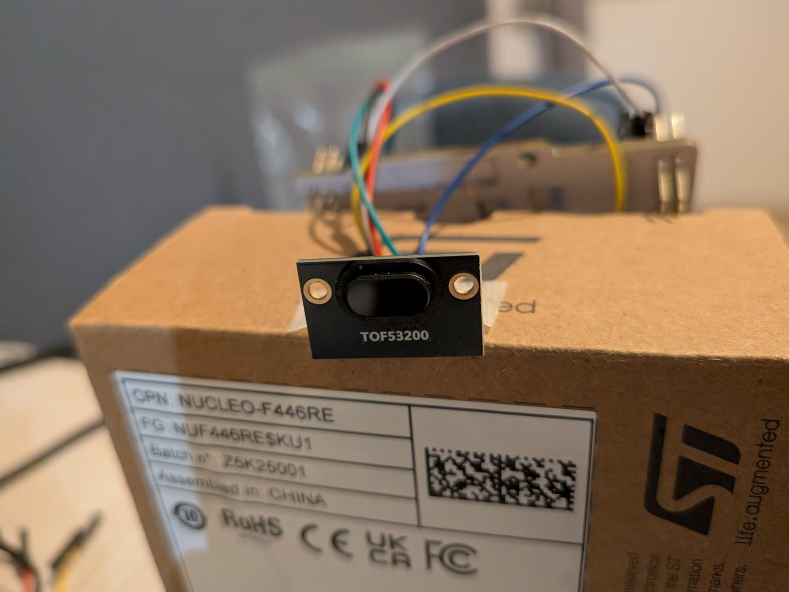 |
| [`04_smoketest_tof_range_test.jpg`](photos/04_smoketest_tof_range_test.jpg) | [`05_smoketest_tof_nucleo_wiring.jpg`](photos/05_smoketest_tof_nucleo_wiring.jpg) | [`06_smoketest_tof53200_sensor_closeup.jpg`](photos/06_smoketest_tof53200_sensor_closeup.jpg) |

| Motor + Encoder Bench | SG90 Brake Servo Wiring |
| :---: | :---: |
| 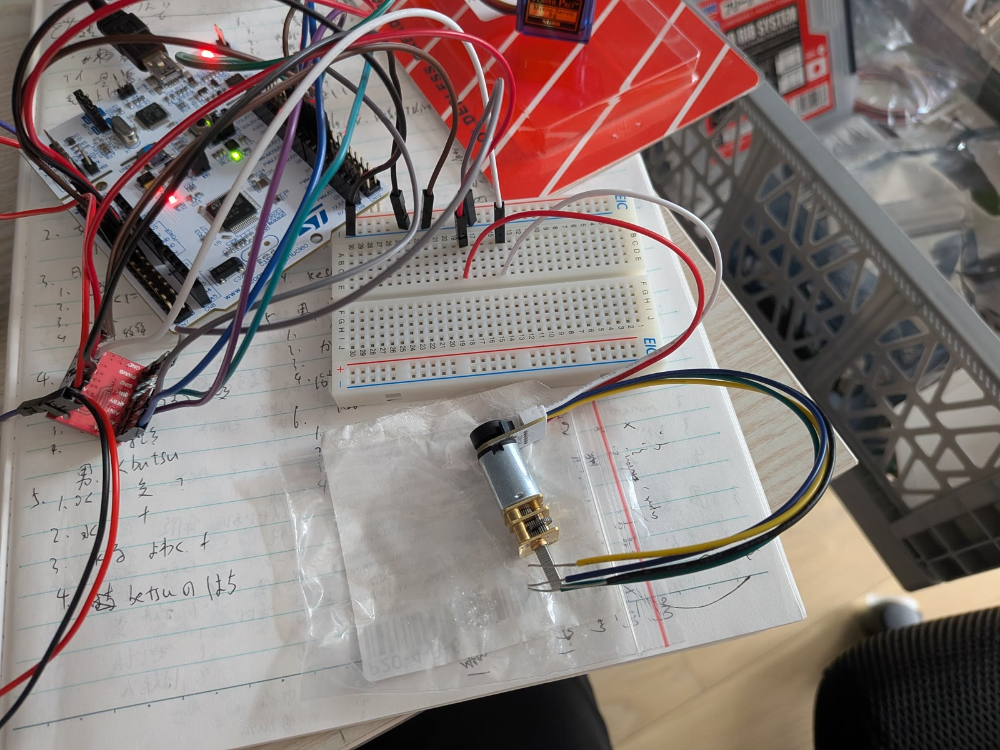 | 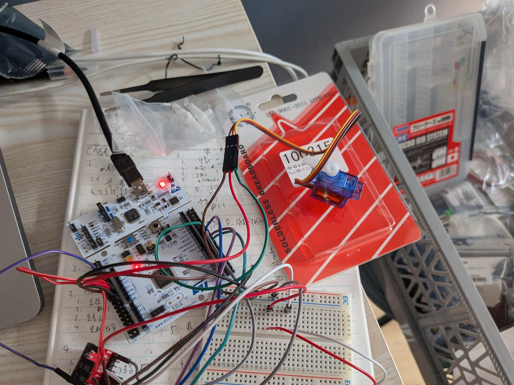 |
| [`07_smoketest_motor_encoder_bench.jpg`](photos/07_smoketest_motor_encoder_bench.jpg) | [`08_smoketest_sg90_servo_wiring.jpg`](photos/08_smoketest_sg90_servo_wiring.jpg) |
