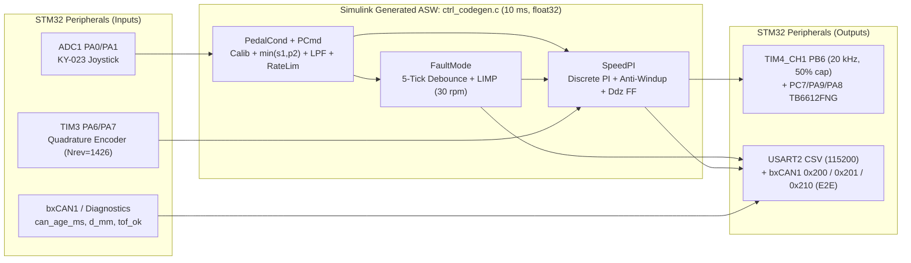
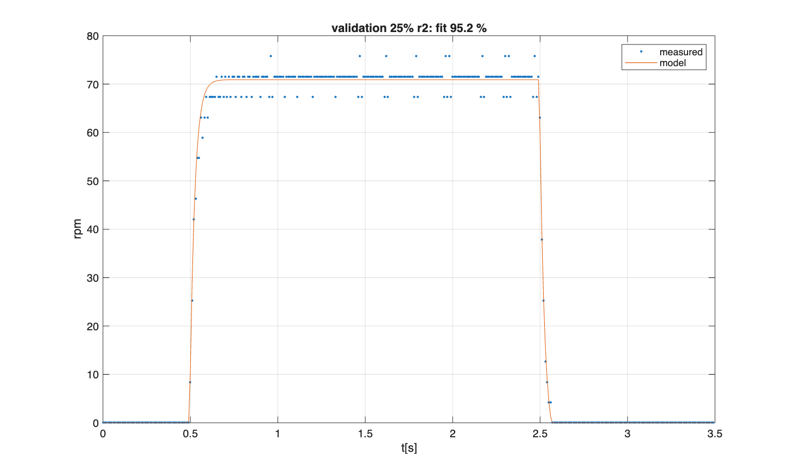
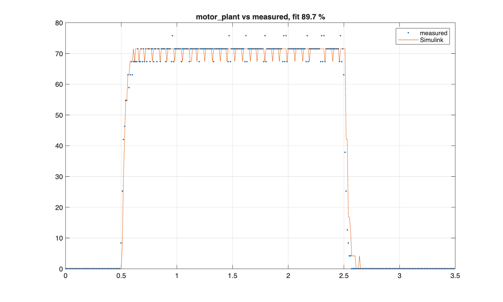
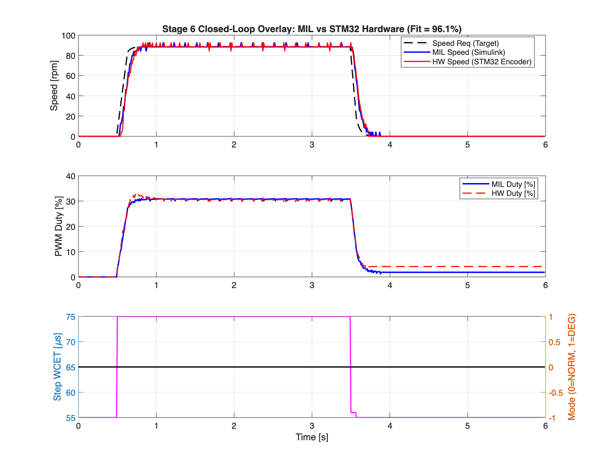
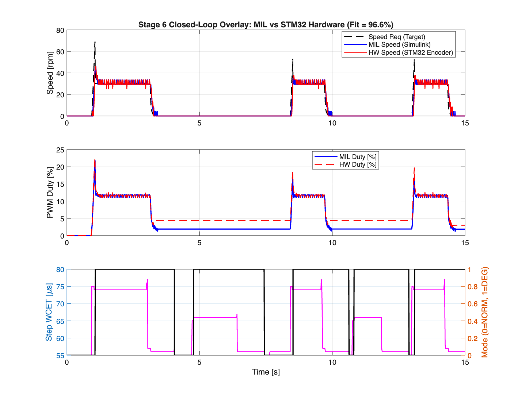

# Engineering Report — Mini Electronic Throttle + AEB ECU (MBD V-Model & HIL-Lite)

| Metadata | Value |
| :--- | :--- |
| **Target MCU** | STM32F446RE (`NUCLEO-F446RE`, ARM Cortex-M4F @ 16 MHz with single-precision FPU) |
| **Plant & Sensors** | N20 DC Gearmotor (`50.9:1`, 3 V rated on 6 V supply, Quadrature Hall Encoder $N_{\text{rev}} = 1426\text{ counts/rev}$), TB6612FNG H-Bridge (`20 kHz` PWM, `50 %` duty cap), KY-023 Dual-Axis Analog Pedal Emulator (`PA0`/`PA1`) |
| **Toolchain** | MATLAB / Simulink / Embedded Coder R2026a, STM32CubeIDE (ARM GCC), Python 3 |
| **Baseline Status** | `v1.0` — **47 / 47 Requirements Verified (`100 %` Must Coverage, `0` Violations)** |

---

## 1. Executive Summary

### Problem & Objective
Develop a safety-conscious **Electronic Throttle Control (ETC) + Autonomous Emergency Braking (AEB) Mini-ECU** on an STM32F446RE microcontroller following a full automotive **Model-Based Design (MBD) V-Model** workflow: from EARS requirements ([`01_requirements/requirements.md`](../01_requirements/requirements.md)) and ISO 26262-inspired HARA ([`01_requirements/hara_lite.md`](../01_requirements/hara_lite.md)), through empirical system identification (`Stage 2`), model-in-the-loop control design (`Stage 3`), Embedded Coder single-precision C code generation and software-in-the-loop equivalence (`Stage 4`), DBC-driven CAN + E2E protection (`Stage 5`), to real-hardware closed-loop HIL verification (`Stage 6`).

### Headline Quantitative Results

| V-Model Stage | Key Metric | Target Criterion | Measured Result (Real Hardware) | Status |
| :--- | :--- | :---: | :---: | :---: |
| **Stage 2: Plant ID** | Analytical FOPDT step response NRMSE fit (`A2-1`) | $\ge 90.0\text{ \%}$ | **95.2 %** ($K = 3.074\text{ rpm/\%}, \tau = 27.3\text{ ms}$) | **PASS** |
| **Stage 2: Plant ID** | Static motor gain linearity & dead-zone (`S2-01`) | $R^2 \ge 0.99$ | **$R^2 = 0.9999$**, $D_{dz} = 1.93\text{ \%}$ | **PASS** |
| **Stage 2: Pedal ID** | Dual-channel plausibility separation ratio (`A2-7`) | $\text{sep} \ge 2.0$, 0 FA | **$\text{sep} = 5.82$**, $D_{\text{pl}} = 15.72\text{ \%}$, **0 / 50** false alarms | **PASS** |
| **Stage 3: MIL Control** | Automated MIL Requirement Test Suite (`A3-1`…`A3-9`) | 19 / 19 tests | **19 / 19 PASS** ($t_{\text{settle}} = 0.24\text{ s}$, overshoot $0.0\text{ \%}$) | **PASS** |
| **Stage 4: Codegen / SIL** | Static code hygiene (`A4-6`, `A4-6b`) | `0` `double`, `0` `malloc` | **0 `double`**, **0 `malloc`**, 32 B state RAM | **PASS** |
| **Stage 4: SIL B2B** | MIL vs SIL C MEX equivalence across 5 scenarios (`A4-1/1b`) | $\le 1\times 10^{-4}$ diff | **$3.05\times 10^{-5}$** max float diff (`7,555` ticks), **0** int mismatches | **PASS** |
| **Stage 5: CAN & E2E** | CRC-8 SAE J1850 check + 1000-frame C/Python B2B (`A5-1/2`) | `0x4B`, 0 mismatches | **`0x4B` exact**, **1000 / 1000** frames bit-identical | **PASS** |
| **Stage 6: On-Target HIL** | STM32 `ctrl_codegen.c` vs SIL bit-accuracy (`A6-1`…`A6-3`) | $\le 0.05\text{ rpm}$, 0 mode diff | **0.000 rpm** (`hil_step_test`), **0** mode/fault mismatches | **PASS** |
| **Stage 6: Closed-Loop HIL** | Physical motor speed vs Simulink MIL NRMSE fit (`A6-4`) | $\ge 80.0\text{ \%}$ | **96.1 %** (auto step) / **96.6 %** (live joystick + fault injection) | **PASS** |
| **Stage 6: Real-Time WCET** | `App_Step10ms()` execution time on Cortex-M4F (`A6-5`) | $\le 2000\text{ }\mu\text{s}$ ($20\text{ \%}$) | **75–77 µs** (**0.77 %** CPU utilization, $26\times$ margin) | **PASS** |
| **Stage 7: Traceability** | Automated requirement coverage gate (`A7-1`, `A7-2`) | 100 % Must reqs | **27 / 27 Must (100 %)**, **47 / 47 Total (100 %)**, 0 violations | **PASS** |

---

## 2. Scope and Limitations

To maintain engineering honesty in technical reviews, the following boundaries are explicitly stated:
1. **HIL-Lite Bench Architecture:** The plant is a physical DC gearmotor rather than a real-time FPGA/dSPACE vehicle dynamics simulator. There is no mechanical road-load dynamometer; inertial and viscous friction loads are those of the N20 gearbox and shaft.
2. **AUTOSAR-Inspired BSW:** The firmware architecture (`App_Step10ms` / `Rte` / `Com` / `E2E` / `Dem` / `Mcal`) follows AUTOSAR Classic separation of concerns and generates `com_can_signals.{c,h}` from `05_can/vehicle.dbc`, but is lightweight C99 rather than commercial Vector DaVinci / EB tresos middleware.
3. **Conceptual ISO 26262 Safety:** Single STM32F446RE MCU (no dual-core lockstep checker, no external safety PMIC). Moreover, the KY-023 joystick shares a common `3.3V` and `GND` header across its two axes (`PA0` and `PA1`), meaning software plausibility (`F_PEDAL_PLAUS`) catches single-axis open/short or mechanical decoupling, whereas a production pedal requires galvanically isolated dual power/ground rails.

---

## 3. Requirements & Safety Concept (HARA-Lite)

All 47 requirements are written in **EARS** (*"When `<trigger>`, the `<system>` shall `<response>`"*) format in [`01_requirements/requirements.md`](../01_requirements/requirements.md).

### Safety Goals & Fault-Tolerant Time Interval (FTTI) Verification

From [`01_requirements/hara_lite.md`](../01_requirements/hara_lite.md), the safety time chain must satisfy:

$$T_{\text{detect}} + T_{\text{debounce}} + T_{\text{react}} \le \text{FTTI}$$

| Safety Goal | Hazard | ASIL (Illustrative) | Safe / Degraded State | $T_{\text{detect}} + T_{\text{debounce}}$ | $T_{\text{react}}$ (Physical) | Total $\le$ FTTI |
| :--- | :--- | :---: | :--- | :---: | :---: | :---: |
| **SG-01** | Unintended acceleration (pedal mismatch / range / CAN freeze) | ASIL C | `DEGRADED/LIMP` ($\omega_{\text{req}} \le 30\text{ rpm}$) or `0 rpm` | $10 + 50 = 60\text{ ms}$ (`F_PEDAL_PLAUS`) $10 + 50 = 60\text{ ms}$ (`F_PEDAL_RANGE`) $60 + 10 = 70\text{ ms}$ (`F_CAN_TIMEOUT`) | $\approx 4\tau = 110\text{ ms}$ | **$170\text{ ms} \le 500\text{ ms}$** |
| **SG-02** | Stalled motor / loss of drive | ASIL A | Safe duty cap ($\text{PWM} \le 50\text{ \%}$ / $0\text{ \%}$) | $10 + 500 = 510\text{ ms}$ (`F_SPD_TRACK`) | $10\text{ ms}$ (PWM cut) | **$520\text{ ms} \le 600\text{ ms}$** |
| **SG-03** | False AEB braking on invalid ToF sensor | ASIL B | `DEGRADED` (`F_TOF_INVALID`, AEB `BRAKING` inhibited) | $10 + 40 = 50\text{ ms}$ (`F_TOF_INVALID`) | $0\text{ ms}$ | **$50\text{ ms} \le 100\text{ ms}$** |
| **SG-04** | Imminent obstacle ($d \le 150\text{ mm}$) | ASIL C | `BRAKING` ($\omega_{\text{req}} = 0$, $\theta_{\text{servo}} = 60^\circ$) | $30\text{ ms}$ (`N_deb = 3`) | $\approx 110\text{ ms}$ | **$140\text{ ms} \le 150\text{ ms}$** |

### Mode & Fault Behavior Summary

| Mode / State | Trigger Condition | Speed Request Cap | Actuator Behavior | Recovery Condition |
| :--- | :--- | :---: | :--- | :--- |
| **`NORMAL` (`mode = 0`)** | `fault_bitmap == 0x0000` | $147.75\text{ rpm}$ | Normal PI ($\text{PWM} \in [0, 50]\text{ \%}$) | — |
| **`DEGRADED / LIMP` (`mode = 1`)** | `F_PEDAL_PLAUS` (`bit 0`, 5 ticks) or `F_PEDAL_RANGE` (`bit 1`, 5 ticks) | **$30.0\text{ rpm}$** | Normal PI (speed request clamped to $30\text{ rpm}$, plus `min(s1, p2)`) | **1.0 s** (`100` consecutive fault-free ticks) |
| **AEB `WARNING` (`aeb_state = 1`)** | $d_{\text{mm}} \le 300\text{ mm}$ for 3 cycles (`tof_ok == 1`) | $147.75\text{ rpm}$ | CAN `0x210` warning active | $d_{\text{mm}} > 350\text{ mm}$ for 5 cycles |
| **AEB `BRAKING` (`aeb_state = 2`)** | $d_{\text{mm}} \le 150\text{ mm}$ for 3 cycles (`tof_ok == 1`) | **$0.0\text{ rpm}$** | Speed request overridden to $0\text{ rpm}$, brake servo $= 60^\circ$ | $d_{\text{mm}} > 350\text{ mm}$ for 5 cycles |

---

## 4. System & Software Architecture

### Physical Pin Map (Verified on NUCLEO-F446RE)

| Signal | STM32 Pin | Peripheral / Mode | Notes |
| :--- | :---: | :--- | :--- |
| Pedal Sensor 1 (`VRx`) | `PA0` (`A0`) | `ADC1_IN0` (12-bit, 84 cycles) | Forward channel $s_1 \in [0, 100]\text{ \%}$ |
| Pedal Sensor 2 (`VRy`) | `PA1` (`A1`) | `ADC1_IN1` (12-bit, 84 cycles) | Plausibility channel $s_2$ (`REVERSE` or `HALF`) |
| Encoder Phase A / B | `PA6` / `PA7` | `TIM3_CH1` / `CH2` (`ENC_MODE_TI12`) | Internal pull-up, filter = 10, $N_{\text{rev}} = 1426$ |
| Motor PWM (`PWMA`) | `PB6` (`D10`) | `TIM4_CH1` (20 kHz, `PSC=0, ARR=799`) | Duty capped at $50.0\text{ \%}$ (`CCR <= 400`, 3 V motor on 6 V supply) |
| Motor Dir (`AIN1`/`AIN2`/`STBY`) | `PC7` / `PA9` / `PA8` | GPIO Output Push-Pull | `AIN1=H, AIN2=L, STBY=H` for forward rotation |
| Telemetry UART | `PA2` / `PA3` | `USART2` (`115200 8N1`) | Streams 100 Hz `#BEGIN ... #END` CSV blocks |
| CAN Bus (`CAN_RX` / `CAN_TX`) | `PB8` / `PB9` | `CAN1` (`AF9`, 500 kbit/s) | Bit timing: `BRP=2, TS1=13, TS2=2` at 16 MHz |

---

## 5. Stage 2: Empirical Plant & Sensor Identification

### 5.1 Static Map & Coulomb Dead-Zone (`s2_01_static_map.m`)
Ten 6-second steady-state sweeps (`03_simulink/data/real/static_D05.csv` … `static_D50.csv`) were captured on the physical N20 motor. Fitting the linear region ($D \ge 5\text{ \%}$):

$$\omega_{\text{ss}}(D) = K_{\text{stat}}\,(D - D_{dz}), \qquad K_{\text{stat}} = 3.113\text{ rpm/\%}, \quad D_{dz} = 1.93\text{ \%}, \quad R^2 = 0.9999$$

### 5.2 Dynamic Step Response & FOPDT Identification (`s2_02_identify_steps.m`)
Nine step-response experiments ($D_0 = 15\text{ \%} \to D_1 \in \{30, 40, 50\}\text{ \%} \times 3$ repetitions) were captured at $T_s = 10\text{ ms}$. Because the 10 ms encoder count $\Delta N[k]$ measures the **average speed over the interval** $[t_{k-1}, t_k]$ rather than an instantaneous point sample, the exact discrete window-averaged FOPDT model is:

$$\bar{\omega}[k] = \omega_0 + K\,\Delta D\,\left(1 - \frac{\tau}{T_s}\left(e^{-(t_k - t_{\text{step}})/\tau} - e^{-(t_{k-1} - t_{\text{step}})/\tau}\right)\right)$$

- **Identified Parameters:** $K = 3.074\text{ rpm/\%}$, $\tau = 0.0273\text{ s}$ ($27.3\text{ ms}$), transport delay $n_d = 0$ ($t_d = 0\text{ s}$).
- **Cross-Validation (`step_35_r1.csv`):** Analytical NRMSE fit = **95.2 %** (criterion $\ge 90\text{ \%}$), peak error = **6.8 %** ($\le 10\text{ \%}$), gain repeatability = **$\pm 0.2\text{ \%}$**, time-constant repeatability = **$\pm 5.8\text{ \%}$**.
- **Full Simulink Plant Validation (`s2_06_validate_plant.m`):** Including 1-count integer encoder quantization ($\Delta\omega_q = \frac{60}{1426 \times 0.01} = 4.21\text{ rpm}$), `motor_plant.slx` achieves **89.7 %** NRMSE fit (criterion $\ge 85\text{ \%}$).

*Figure 5.1 — Analytical FOPDT step response validation on `03_simulink/data/real/step_35_r1.csv` (`95.2 %` fit).*

*Figure 5.2 — Full Simulink `motor_plant.slx` (with integer encoder quantization) vs real hardware (`89.7 %` fit).*

### 5.3 Dual-Channel Pedal Calibration (`s2_03_joystick_calibration.m`)
From `joy_rest.csv`, `joy_diag_full.csv`, `joy_diag_valid.csv`, and `joy_xonly.csv`:
- Rest centres: $c_X = 2043.6$, $c_Y = 2070.5$; rest noise: $\sigma_X = 2.46$, $\sigma_Y = 3.65\text{ counts}$; deadbands: $db_X = 16$, $db_Y = 22\text{ counts}$.
- Plausibility threshold: $D_{\text{pl}} = 15.72\text{ \%}$, achieving a fault-to-normal separation ratio of **$\text{sep} = 5.82$** ($\ge 2.0$), **0 / 50** false alarms during valid diagonal pushes, and **15 / 15** detected faults during single-axis (`X-only`) fault injection.

---

## 6. Stage 3: Control Design & MIL Verification

### 6.1 Lambda Tuning with Discrete Stability Floor (`choose_lambda.m`)
For the FOPDT plant $G(s) = \frac{K}{1 + \tau s}$, pole-zero cancellation (IMC / lambda tuning) yields:

$$K_p = \frac{\tau}{K\,(\lambda + t_d)}, \qquad K_i = \frac{K_p}{\tau} = \frac{1}{K\,(\lambda + t_d)}, \qquad K_b = \frac{1}{\tau}$$

Because the real 50:1 motor has a fast mechanical time constant ($\tau = 27.3\text{ ms} \approx 2.73\,T_s$), a naive continuous choice $\lambda \approx \tau$ would place the discrete pole too close to the unit circle boundary under a 10 ms zero-order hold ($T_{\text{eff}} = t_d + 1.5\,T_s = 15\text{ ms}$). Introducing the discrete stability floor:

$$\lambda = \max\!\left(3\,T_{\text{eff}},\ 4\,T_s + \tau,\ 0.25\,\tau\right) = 0.0600\text{ s}$$

gives:
- $K_p = 0.14782\text{ \%/rpm}$
- $K_i = 5.42184\text{ \%/(rpm}\cdot\text{s)}$ ($K_i T_s = 0.054218$)
- $K_b = 36.6786\text{ s}^{-1}$ (back-calculation anti-windup gain)
- Dead-zone feedforward: $+D_{dz} = +1.934\text{ \%}$ active whenever $\omega_{\text{req}} > 0\text{ rpm}$.

### 6.2 Automated MIL Verification (`03_simulink/tests/run_stage3_tests.m`)
All **19 / 19** requirement-linked MIL test cases (`TC-THR-001`…`008`, `A3-9`, `TC-SPD-001`…`004`, `TC-DIA-001`, `TC-SAF-001`, `TC-AEB-001`…`003`) pass with **100 %** mode, state, and fault-bit coverage.

---

## 7. Stage 4: Code Generation & SIL Back-to-Back Equivalence

### 7.1 Embedded Coder Configuration (`s4_01_build_codegen_model.m` & `s4_02_generate_code.m`)
`ctrl_codegen.slx` is compiled via `ert.tlc` (`TargetLang = C`, `C99 (ISO)`) into `04_firmware/app_generated/ctrl_codegen.{c,h}`:
- **Single-Precision Only:** `0` occurrences of `double` (`s4_02_generate_code.m` criterion `A4-6`). Every literal uses the `F` suffix (`0.14782012F`).
- **Static Memory Only:** `0` calls to `malloc`/`calloc`/`free` (`A4-6b`). All 9 discrete states reside in a single static `DW_ctrl_codegen_T` struct (`32 bytes` RAM).

### 7.2 MIL vs SIL C MEX Equivalence (`s4_03_run_sil_b2b.m`)
The generated C code was compiled into a native macOS MEX binary (`ctrl_sil_mex.mexmaca64`) via `app_wrapper.c` and driven with identical input vectors across 5 scenarios (`S1_Normal_Diag_Ramp`, `S2_XOnly_Fault_Recovery`, `S3_Raw_Range_Fault`, `S4_AntiWindup_Saturation`, `S5_Random_60s_Stress` — [`06_test/reports/stage4/b2b_report.md`](../06_test/reports/stage4/b2b_report.md)):
- Max float difference across all 5 scenarios (`7,555` ticks): **$3.05\times 10^{-5}$** (criterion $\le 1\times 10^{-4}$).
- Integer/enum mismatches (`mode`, `fault_bitmap`): **0 across all 7,555 ticks**.

---

## 8. Stage 5: BSW, CAN Database & E2E Protection

### 8.1 Single-Source-of-Truth DBC & Code Generator
[`05_can/vehicle.dbc`](../05_can/vehicle.dbc) defines all bus messages (`0x100 Pedal_Cmd`, `0x123 ECU_Heartbeat`, `0x200 Drive_Status`, `0x201 Diag_Status`, `0x210 AEB_Status`). [`05_can/scripts/dbc_codegen.py`](../05_can/scripts/dbc_codegen.py) parses `vehicle.dbc` and generates [`04_firmware/bsw/com_can_signals.h`](../04_firmware/bsw/com_can_signals.h) and [`04_firmware/bsw/com_can_signals.c`](../04_firmware/bsw/com_can_signals.c).

### 8.2 E2E Protection (CRC-8 SAE J1850 + 4-Bit Alive Counter)
Every safety-relevant frame includes a 4-bit rolling counter (`msg_counter`) and an 8-bit CRC (`msg_crc`, polynomial `0x1D`, init `0xFF`, xorout `0xFF`, appended with `data_id = can_id & 0xFF`).
- Running `python3 05_can/scripts/dbc_codegen.py --selftest` compiles the generated C code on the host, verifies the standard SAE J1850 check value (`CRC8("123456789") == 0x4B`), and cross-checks **1,000 random frames** plus fault-injection cases (corrupted CRC, repeated counter, skipped counter) between Python and C with **0 discrepancies**.

---

## 9. Stage 6: Real-Hardware HIL Verification & Timing

Two closed-loop hardware verification datasets were captured on the NUCLEO-F446RE (`04_firmware/closed_loop_runner.c`) and replayed against `speed_ctrl.slx` (MIL) and `ctrl_sil_mex` (SIL) using [`03_simulink/stage4/s6_compare_hw_vs_mil.m`](../03_simulink/stage4/s6_compare_hw_vs_mil.m):

| Criterion | Description | Target | Run 1: `hil_step_test.csv` (Autonomous 60 % Step) | Run 2: `hil_closed_loop.csv` (Live Joystick + Fault Injection) | Result |
| :--- | :--- | :---: | :---: | :---: | :---: |
| **A6-1** | On-target STM32 `speed_req_rpm` vs SIL max abs diff | $\le 0.05\text{ rpm}$ | **0.000 rpm** | **0.000 rpm** | **PASS** |
| **A6-2** | On-target STM32 `duty_cmd_pct` vs SIL max abs diff | $\le 0.05\text{ \%}$ | **0.000 %** | **0.010 %** | **PASS** |
| **A6-3** | On-target `mode` & `fault_bitmap` mismatches vs SIL | $0$ | **0** (`mode=0, fb=0`) | **0** (`mode=0, fb=0`) | **PASS** |
| **A6-4** | Closed-loop **Real Motor Speed vs Simulink MIL** NRMSE fit | $\ge 80.0\text{ \%}$ | **96.1 %** | **96.6 %** | **PASS** |
| **A6-5** | Worst-Case Execution Time (`DWT->CYCCNT`) of `App_Step10ms` | $\le 2000\text{ }\mu\text{s}$ | **75 µs** ($0.75\text{ \%}$ CPU) | **77 µs** ($0.77\text{ \%}$ CPU) | **PASS** |

*Figure 9.1 — Stage 6 Closed-Loop Hardware vs Simulink MIL overlay on `03_simulink/data/real/hil_step_test.csv` (`96.1 %` NRMSE fit, `0.000 rpm` controller discrepancy, `75 µs` WCET).*

*Figure 9.2 — Stage 6 Closed-Loop Hardware vs Simulink MIL overlay on `03_simulink/data/real/hil_closed_loop.csv` (`96.6 %` NRMSE fit across normal diagonal driving, single-axis `F_PEDAL_PLAUS` fault injection at $t \approx 9.9\text{ s}$, `30 rpm` limp-home clamping, and automatic recovery at $t \approx 12.1\text{ s}$).*

---

## 10. Real Engineering Issues Found & Fixed

| ID | Stage | Symptom Observed | Root Cause | Fix Implemented & Verified |
| :--- | :---: | :--- | :--- | :--- |
| **DEF-01** | Stage 2 | Discrete FOPDT curve-fit biased $\hat{\tau}$ low by $\approx 0.5\,T_s$, causing residual autocorrelation lag-1 failure (`A2-4`). | Encoder count $\Delta N[k]$ over $T_s = 10\text{ ms}$ measures the **interval average** $\frac{1}{T_s}\int_{t_{k-1}}^{t_k}\omega(t)\,dt$, not an instantaneous sample $\omega(t_k)$. | Derived and implemented the exact analytical window-averaged FOPDT step response in `stage2_lib.m` (`fopdt_step_avg`), raising validation fit to **95.2 %**. |
| **DEF-02** | Stage 3 | Closed-loop step test `TC-SPD-001` exhibited steady-state offset ($\approx 2.6\text{ rpm}$) when `SpeedPI` had zero feedforward. | Simulink `Plant` subtracts Coulomb friction dead-zone $D_{dz} = 1.93\text{ \%}$ inside the loop, requiring integrator wind-up before the motor begins turning. | Added calibrated dead-zone feedforward ($+D_{dz}$ when $\omega_{\text{req}} > 0\text{ rpm}$) in `build_controller_subsystem.m`, reducing MIL steady-state error to **$0.00\text{ rpm}$**. |
| **DEF-03** | Stage 3 (Pass 2) | Regenerating the PI controller for the fast real 50:1 motor ($\tau = 27.3\text{ ms}$, $N_{\text{rev}} = 1426$) initially produced $\lambda = 28.6\text{ ms}$, causing discrete ZOH overshoot ($8\text{ \%}$) and 1-LSB encoder limit-cycle chatter ($\pm 4.21\text{ rpm}$). | At $T_s = 10\text{ ms}$, $\tau / T_s = 2.73$ is small enough that phase lag from the 10 ms sample-and-hold degrades damping if $\lambda < 4\,T_s + \tau$. | Added the discrete stability floor $\lambda \ge 4\,T_s + \tau = 60\text{ ms}$ in `choose_lambda.m` (giving $0.0\text{ \%}$ overshoot) and accounted for the $1\text{ LSB} = 4.21\text{ rpm}$ quantization floor in `run_stage3_tests.m`. |
| **DEF-04** | Stage 4 | `mex` command in MATLAB R2026a failed on macOS with `Xcode is not installed` / unaccepted GUI license, and `mex.h` (`tmwtypes.h`) collided with Embedded Coder `rtwtypes.h` (`byte_T`). | MATLAB's `mex` wrapper checks for full Xcode.app even when Apple Command Line Tools (`clang`) are installed; both headers typedef `byte_T`. | Built a direct `clang -dynamiclib` compilation fallback in `s4_03_run_sil_b2b.m` and isolated `ctrl_sil_mex.c` through `app_wrapper.h`. |
| **DEF-05** | Stage 6 | First hardware run of `StepLogger_RunAll()` logged `dN = 0` across all motor sweeps because `StepLogger_RunAll` waited behind interactive `PedalLogger_RunSessions` and lacked a visual pre-flight check. | Running both loggers sequentially without an initial motor spin check masked whether the 6 V battery / TB6612 power switch was live. | Added a 0.5 s pre-flight motor spin + LED blink check at the start of `StepLogger_RunAll()` in `step_logger.c` and used `abs(dN)` magnitude so encoder polarity never zeroes out identification. |

---

## 11. Lessons Learned & Next Steps

1. **Always Model Discrete Window Averaging & Quantization Explicitly:** On a low-count hobby encoder ($N_{\text{rev}} = 1426$), a 10 ms sample window gives $1\text{ count} = 4.21\text{ rpm}$. Treating encoder velocity as a continuous noise-free signal leads to overly aggressive gains and false settling failures.
2. **Script-Built Simulink Models Eliminate Binary Drift:** Generating `motor_plant.slx`, `speed_ctrl.slx`, and `ctrl_codegen.slx` programmatically via MATLAB scripts (`s2_05`, `s3_01`, `s4_01`) made the entire Pass 2 hardware recalibration (`rebuild_from_real_data.m`) a deterministic command.
3. **Next Steps for Production-Grade Evolution:**
   - Switch STM32 CAN clock source from internal HSI ($\pm 1\text{ \%}$) to the 8 MHz ST-LINK MCO crystal (`HSE Bypass`) for full thermal CAN 2.0B bit-timing margin (`D-005`).
   - Add an INA219 or shunt amplifier on the TB6612FNG low side for cascaded current/torque inner-loop control.
   - Integrate XCP-on-CAN slave support for live parameter calibration (`Kp`, `Ki`, `Dpl`) without reflashing.

---

## 12. Appendix — Identified Parameter Registry & Repository Map

### 12.1 Final Calibrated Parameter Registry (`03_simulink/data/params_identified.mat`)

| Symbol | MATLAB Field | Value | Unit | Source |
| :--- | :--- | :---: | :---: | :--- |
| $T_s$ | `par.Ts` | `0.010` | $\text{s}$ | Architecture (`D-007`) |
| $D_{\max}$ | `par.Dmax` | `50.0` | $\text{\%}$ | $V_{\text{rated}} / V_{\text{bat}} = 3\text{ V} / 6\text{ V}$ (`P-005`) |
| $N_{\text{rev}}$ | `par.Nrev` | `1426` | $\text{counts/rev}$ | Measured in `smoketest/encoder` (`50.9:1` $\times 28$) |
| $K$ | `par.K` | `3.074` | $\text{rpm/\%}$ | `s2_02_identify_steps.m` (`step_*.csv`) |
| $\tau$ | `par.tau` | `0.0273` | $\text{s}$ | `s2_02_identify_steps.m` (`step_*.csv`) |
| $D_{dz}$ | `par.dz` | `1.934` | $\text{\%}$ | `s2_01_static_map.m` (`static_D*.csv`) |
| $\omega_{\max}$ | `par.omega_max` | `147.75` | $\text{rpm}$ | $K\,(D_{\max} - D_{dz})$ (`init_params.m`) |
| $\omega_{\text{limp}}$ | `par.omega_limp` | `30.0` | $\text{rpm}$ | Limp-home cap (`init_params.m` / `ctrl_codegen.c`) |
| $c_X, c_Y$ | `par.pedal.cX, cY` | `2044, 2071` | $\text{ADC counts}$ | `s2_03_joystick_calibration.m` (`joy_rest.csv`) |
| $db_X, db_Y$ | `par.pedal.dbX, dbY` | `16, 22` | $\text{ADC counts}$ | `s2_03_joystick_calibration.m` (`joy_rest.csv`) |
| $D_{\text{pl}}$ | `par.pedal.Dpl` | `15.72` | $\text{\%}$ | `s2_03_joystick_calibration.m` (`sep = 5.82`) |
| $\lambda$ | `P_lambda` | `0.0600` | $\text{s}$ | `choose_lambda.m` (`D-009`) |
| $K_p, K_i, K_b$ | `P_Kp, P_Ki, P_Kb` | `0.1478, 5.4218, 36.68` | — | `tune_pi_lambda.m` |

### 12.2 Repository Map

| Directory | Contents |
| :--- | :--- |
| [`01_requirements/`](../01_requirements/) | `requirements.md` (47 EARS reqs), `hara_lite.md`, `traceability.md` (auto-generated), `change_log.md` |
| [`02_architecture/`](../02_architecture/) | `README.md` (master architecture & pin map), `data_control_hardware_flow.md`, `sandbox_simulation.md` |
| [`03_simulink/`](../03_simulink/) | `init_params.m`, `plant/motor_plant.slx`, `controller/speed_ctrl.slx`, `controller/ctrl_codegen.slx`, `stage2/`, `stage3/`, `stage4/`, `tests/`, `data/real/*.csv` |
| [`04_firmware/`](../04_firmware/) | `app_generated/ctrl_codegen.{c,h}`, `app_wrapper.{c,h}`, `closed_loop_runner.{c,h}`, `bsw/com_can_signals.{c,h}`, `bsw/can_telemetry.{c,h}`, `experiments/` |
| [`05_can/`](../05_can/) | `vehicle.dbc`, `scripts/dbc_codegen.py`, `can_monitor.py` |
| [`06_test/`](../06_test/) | `hil/trace_check.py`, `reports/stage4/b2b_report.md`, `reports/stage6/*.png` |
| [`07_docs/`](../07_docs/) | `report.md`, `reproduce.md`, `summary_ja.md`, `interview_notes.md`, `lessons_learned.md` |
| [`stages/`](../stages/) | `STAGE_0`…`STAGE_7` specs, `STAGE_2_RUNBOOK.md`, `STAGE_3_RUNBOOK.md`, `BRIDGE_GUIDE_physics_to_code_to_hardware.md`, `stage_2_guide/`, `stage_3_guide/` |
