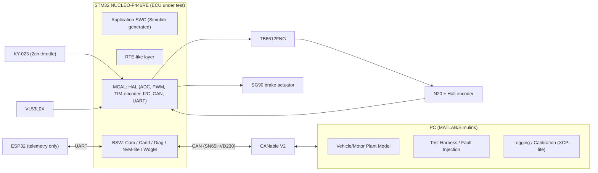
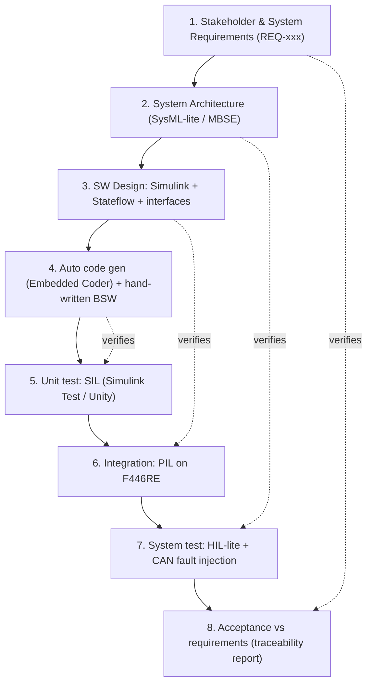

# MBD / HILS Project Blueprint — "Mini Electronic Throttle + AEB ECU"

Goal: build a portfolio project that mirrors the Japanese OEM/Tier1 job description
(MBD, MBSEによる上流設計, ECU BSW構築, 要求分析, ECU検査) using the hardware in
[`Lab_Hardware/list.md`](../Lab_Hardware/list.md).

## 1. Feasibility verdict

**Yes — a scaled-down but credible version is feasible.** You cannot replicate real
AUTOSAR/ISO 26262 tooling (Vector DaVinci, EB tresos, dSPACE), but you CAN demonstrate
the *process and the thinking*, which is what matters for a junior/no-experience applicant.

| JD keyword | What you can show | Hardware / Tool | Coverage |
| :--- | :--- | :--- | :---: |
| MBD (MATLAB/Simulink) | Plant + controller models, MIL | Simulink, Stateflow | High |
| V字プロセス | Requirements → design → code → test traceability | Simulink Requirements/Test (or Markdown + pytest) | High |
| 自動コード生成 | Embedded Coder → STM32 | NUCLEO-F446RE | High (needs license/support package) |
| SIL / PIL / HIL | SIL (code on PC), PIL (on F446RE), HIL-lite (real motor + sensors) | N20 motor + encoder, TB6612 | Medium–High |
| 要求分析 / MBSE | SysML-lite block diagrams, requirement IDs, safety goals | Mermaid / Cameo-free tools (Capella, PlantUML) | Medium |
| CAN / ECU検査 | DBC, CAN signal tests, fault injection | CANable V2 + SN65HVD230 | High |
| BSW構築 / コンフィグツール | Hand-built layered BSW (MCAL-ish → ComM/PduR/Com-like) configured from YAML/DBC generator | STM32 HAL/LL + Python generator | Medium (AUTOSAR-inspired, not certified) |
| 機能安全 (ISO 26262) | HARA-lite, redundant ADC, watchdog, plausibility | KY-023 dual axis, IWDG | Low–Medium (conceptual) |

### Gaps to be honest about
- **CAN needs 2 nodes**: CANable ↔ NUCLEO (via SN65HVD230). Bus needs 120 Ω at both ends. The SN65HVD230 module already has one (R2 across CANH/CANL); the CANable end needs its termination jumper/pad closed, or one external 120 Ω. Power off and measure CANH–CANL: ≈60 Ω = OK.
- **Hardware is 3 V/small N20 motor**: it's a *speed-control plant*, not a real powertrain. Frame it as a "scaled plant".
- **MATLAB licensing**: Embedded Coder + STM32 support needs licenses (MATLAB Home + add-ons is affordable; or university license). See fallback in §6.
- **ToF (VL53L0X) range is ~1–2 m**: use it for a tabletop AEB demo (target = a card moving toward the sensor).
- **No dedicated HIL box**: your "HIL" = Simulink real-time-ish model on PC (via UART/CAN) exchanging signals with the ECU. Be explicit that it is *HIL-lite*.

## 2. System concept



## 3. Use cases (keep scope small)

| ID | Function | Domain | Notes |
| :--- | :--- | :--- | :--- |
| UC1 | Electronic throttle → motor speed PID | Powertrain | KY-023 X/Y as redundant pedal sensors with plausibility check |
| UC2 | AEB / FCW state machine | ADAS | VL53L0X distance → warn → brake (SG90) |
| UC3 | CAN signaling + diagnostics | Network/Diag | DBC-defined messages, DTC-lite (sensor fault, CAN timeout) |
| UC4 | Cabin temp (optional) | Body | Grove temp → fan/threshold logic |

Do UC1 + UC3 first, UC2 second. UC4 only if time remains.

## 4. V-model mapping



> [!IMPORTANT]
> The detailed, stage-by-stage specification (goals, math, interfaces, acceptance criteria, expected issues) is in [PRODUCT_SPEC.md](PRODUCT_SPEC.md) and `stages/STAGE_0` … `STAGE_7`. This blueprint remains the high-level overview.

## 5. Roadmap (≈ 12–14 weeks, part-time)

| Phase | Weeks | Deliverables | Done when |
| :--- | :---: | :--- | :--- |
| 0. Setup | 1 | Toolchain (MATLAB, STM32CubeIDE/CubeMX, Embedded Coder STM32 support), repo skeleton | Blinky generated from Simulink runs on F446RE |
| 1. Requirements & MBSE | 2 | `01_requirements/` REQ list (EARS style), HARA-lite, block/sequence diagrams, 日本語/English glossary | ≥25 requirements w/ IDs & verification method |
| 2. Plant modeling | 2 | N20 motor model (system ID from encoder step response), vehicle longitudinal model | Model matches measured step response (<10% error) |
| 3. Control design (MIL) | 2 | PID tuned, anti-windup, throttle plausibility, AEB Stateflow | MIL tests pass in Simulink Test |
| 4. Code gen & SIL/PIL | 2 | Generated C, SIL/PIL equivalence report (back-to-back) | PIL vs MIL error within tolerance; stack/exec-time profiled |
| 5. BSW & CAN | 2 | Layered BSW, DBC, config generator, CAN tx/rx, DTC-lite, watchdog | CANable sees cyclic frames; timeout DTC set/cleared |
| 6. HIL-lite & ECU test | 2 | Python/MATLAB test scripts, fault injection (sensor open, CAN loss, stuck pedal), test report | All requirements traced to passed tests |
| 7. Polish | 1 | README, demo video, traceability matrix, Japanese summary (職務経歴書 use) | Reviewer can reproduce in 1 hour |

## 5b. Phase 0 checklist (verify before starting)

**MATLAB (run `ver` in the Command Window, or Home → Add-Ons → Manage Add-Ons)**

- [x] MATLAB Coder
- [x] Simulink Coder
- [x] Embedded Coder
- [x] Simulink
- [x] Stateflow
- [x] Embedded Coder Support Package for STMicroelectronics STM32 Processors (Add-On Explorer; free)
- [x] STM32CubeIDE / STM32CubeMX installed (and STM32CubeProgrammer, ST-LINK drivers)
- [x] Optional: Simulink Test, Simulink Requirements, Simulink Check (MISRA), Control System Toolbox, System Identification Toolbox

**Hardware / CAN**

- [x] SN65HVD230 module wired: D→CAN_TX, R→CAN_RX, 3.3V, GND (R2 = 120 Ω already on board; R1 10 kΩ on Rs = high-speed mode)
- [x] CANable V2: 120 Ω switch set to ON
- [x] Power off, multimeter CANH↔CANL ≈ 60 Ω
- [x] CANable firmware flashed (candleLight or slcan), PC sees the device
- [x] Common GND between all boards; motor/servo on the separate 4×AA supply

**Smoke tests**

- [x] NUCLEO-F446RE works (Lab02–Lab16 + `smoketest/{joystick,encoder,motor}` done)
- [x] Simulink generated code (`ctrl_codegen.c`) runs at 100 Hz on NUCLEO-F446RE (`75–77 µs` WCET)
- [x] CAN DBC codegen + E2E CRC-8 1000-frame self-test & closed-loop HIL verification completed

## 6. Fallbacks if MATLAB add-ons are unavailable

- Simulink → use **Embedded Coder** (preferred). Alternative: STM32 **“STM32-MAT/TARGET”** (free, ST) for code gen with CubeMX.
- No Embedded Coder at all → implement the algorithm in Simulink for MIL, hand-port to C, and validate with SIL by back-to-back test. Weaker but still demonstrates V-model.
- MBSE tools: **Capella**, **PlantUML**, or **Mermaid** (in this repo) instead of Cameo/MagicDraw.

## 7. Proposed repository layout

```
MBD_HILS_Project/
├── BLUEPRINT.md
├── 01_requirements/     # REQ-xxx, HARA-lite, traceability matrix
├── 02_architecture/     # SysML-lite diagrams, interface/signal list
├── 03_simulink/         # plant/, controller/, tests/ (.slx, .m)
├── 04_firmware/         # CubeMX project, generated code, handwritten BSW
├── 05_can/              # DBC, cantools scripts
├── 06_test/             # HIL-lite scripts, fault injection, reports
└── 07_docs/             # demo video, 日本語 summary
```

## 8. Open-source references

> [!NOTE]
> Links are from memory of well-known projects; please verify each still exists/is maintained before relying on it.

**Simulink ↔ STM32 / code generation**
- STMicroelectronics STM32-MAT/TARGET (Simulink target for STM32): https://github.com/STMicroelectronics/STM32-MAT-TARGET
- MathWorks Embedded Coder Support Package for STM32 (File Exchange / Add-On Explorer): https://www.mathworks.com/matlabcentral/fileexchange/ (search "STM32 Embedded Coder")
- STM32CubeF4 HAL/LL drivers: https://github.com/STMicroelectronics/STM32CubeF4

**CAN / diagnostics tooling**
- CANable firmware (candleLight): https://github.com/candle-usb/candleLight_fw
- CANable slcan firmware: https://github.com/normaldotcom/canable-fw
- python-can: https://github.com/hardbyte/python-can
- cantools (DBC parse/codegen): https://github.com/commaai/opendbc (DBC examples) and https://github.com/cantools/cantools
- can-utils: https://github.com/linux-can/can-utils

**Calibration / measurement (XCP / A2L)**
- pyXCP: https://github.com/christoph2/pyxcp
- pyA2L: https://github.com/christoph2/pyA2L

**Test / BSW-style practice**
- Unity (C unit testing): https://github.com/ThrowTheSwitch/Unity
- FreeRTOS: https://github.com/FreeRTOS/FreeRTOS-Kernel
- Zephyr RTOS (modern embedded structure reference): https://github.com/zephyrproject-rtos/zephyr

**AUTOSAR learning (search on GitHub; maturity varies)**
- Search terms: `autosar classic open source`, `Arctic Core`, `AUTOSAR BSW stm32`
- Official concepts: https://www.autosar.org/ (specs are public downloads)

**MBSE**
- Eclipse Capella: https://github.com/eclipse-capella/capella
- PlantUML: https://github.com/plantuml/plantuml

## 9. Key talking points for Japanese interviews

- 「V字モデルに沿って、要求→設計→コード生成→PIL→HILライクな検証まで一貫して実施」
- Back-to-back (MIL/SIL/PIL) equivalence and traceability matrix
- Conscious limits: AUTOSAR-inspired BSW, not certified; HIL-lite
- Fault injection & diagnostics (DTC, timeout, plausibility) show ECU検査 mindset
- Also study: MISRA C, ASPICE basics, ISO 26262 Part 6, AUTOSAR Classic layered architecture, CAN/CAN-FD, UDS (ISO 14229) — these appear in JDs more than tool names.

## 10. Hardware shopping gaps (cheap)

- 1 × 120 Ω resistor (only if the CANable has no termination jumper/pad; the SN65HVD230 module already has one)
- Optional: second STM32/ESP32 as a simulated 2nd ECU
- Optional: logic analyzer (Saleae clone) for debugging CAN/I2C
- Optional: 3.3 V ↔ 5 V level shifter for the 5 V Grove parts
