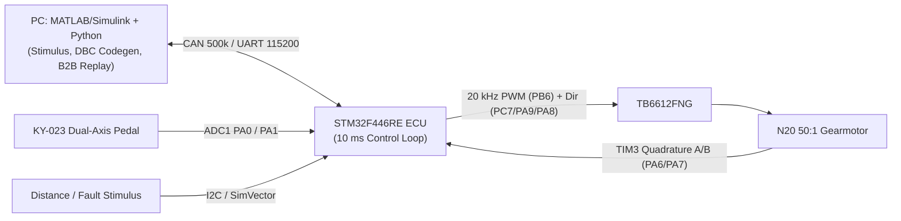

# Product Specification — Mini Electronic Throttle + AEB ECU (MBD / HIL-Lite)

| Field | Value |
| :--- | :--- |
| **Document** | `PRODUCT_SPEC.md` (Master Specification) + `stages/STAGE_0 … STAGE_7` |
| **Version** | `1.0` (Baselined — All 7 Stages Completed & Verified) |
| **Status** | Completed Baseline (`47 / 47` Requirements Verified, `0` Violations). Logged in [`01_requirements/change_log.md`](01_requirements/change_log.md) |
| **Related** | [`README.md`](README.md), [`BLUEPRINT.md`](BLUEPRINT.md), [`requirements.md`](01_requirements/requirements.md), [`report.md`](07_docs/report.md), [`data_control_hardware_flow.md`](02_architecture/data_control_hardware_flow.md) |

> [!NOTE]
> **How to read this specification.** This master document defines the global conventions, calibrated parameter registry (`P-001`…`P-020`), and software interface contracts (`Rte_AppIn_t`, `Rte_AppOut_t`, `CanTelemetry_Step10ms`) shared across all V-Model stages.
> Each stage document in [`stages/`](stages/) contains: *Goal → Inputs → Tasks → Math → Interfaces → Deliverables → Acceptance Criteria → Expected Issues.*

---

## 1. Product Definition

### 1.1 Purpose
A bench-scale ECU on an **STM32F446RE** (`NUCLEO-F446RE`) that demonstrates the **automotive Model-Based Development (MBD) V-process** end to end: EARS requirements & HARA-lite → empirical plant & sensor identification → Simulink/Stateflow MIL control design → single-precision Embedded Coder C99 generation → SIL back-to-back verification → DBC-driven CAN + E2E BSW integration → real-hardware closed-loop HIL-lite verification with fault injection.

### 1.2 Functions (Use Cases)

| UC | Function | Priority | Verification Status |
| :--- | :--- | :---: | :---: |
| **UC1** | Electronic throttle: dual-channel pedal (`KY-023`) → plausibility & range monitoring → speed request → discrete PI + anti-windup + dead-zone FF → 20 kHz PWM (`TB6612FNG`) → N20 gearmotor | **Must** | **Verified (MIL, SIL, HIL)** |
| **UC3** | CAN communication and diagnostics: `vehicle.dbc`-generated pack/unpack, E2E protection (CRC-8 SAE J1850 + 4-bit alive counter), timeout monitor, 16-bit fault bitmap, UDS `0x22`, DWT WCET profiling | **Must** | **Verified (MIL, SIL, HIL)** |
| **UC2** | AEB/FCW: target distance → deterministic state machine (`NORMAL` / `WARNING` / `BRAKING`) → speed override + brake actuator command, with ToF sensor-invalid inhibit | **Should** | **Verified (MIL, SIL)** |
| **UC4** | Cabin temperature display/threshold | **Could** | **Deferred / Out of Scope (`D-002`)** |

### 1.3 Explicit Engineering Boundaries
- **AUTOSAR-Inspired BSW:** The firmware architecture (`App_Step10ms` / `Rte` / `Com` / `E2E` / `Dem` / `Mcal`) follows AUTOSAR Classic separation of concerns and auto-generates `com_can_signals.{c,h}` from `05_can/vehicle.dbc`, implemented in clean C99 rather than proprietary commercial middleware.
- **Conceptual ISO 26262 Safety (HARA-Lite):** Single STM32F446RE MCU (no lockstep core) and shared-rail `KY-023` analog channels (`PA0`/`PA1`). Software plausibility (`F_PEDAL_PLAUS`) and raw range checks (`F_PEDAL_RANGE`) catch single-axis open/short and mechanical decoupling.
- **HIL-Lite Bench Architecture:** Physical 6 V DC gearmotor + optical/Hall quadrature encoder ($N_{\text{rev}} = 1426\text{ counts/rev}$) controlled at 100 Hz by the real STM32F446RE, with the PC acting as stimulus injector, UART/CAN logger, and back-to-back replay verifier.

### 1.4 System Context



---

## 2. Stage Map and Exit Gates

| Stage | Specification | Main Output | Exit Gate Summary | Status |
| :---: | :--- | :--- | :--- | :---: |
| **0** | [`STAGE_0_setup_bringup.md`](stages/STAGE_0_setup_bringup.md) | Verified toolchain & peripherals (`smoketest/`) | All peripheral smoke tests pass | **DONE** |
| **1** | [`STAGE_1_requirements_architecture.md`](stages/STAGE_1_requirements_architecture.md) | 47 EARS requirements, HARA-lite, pin map, budgets | 100 % requirements reviewed & baselined | **DONE** |
| **2** | [`STAGE_2_plant_sensor_models.md`](stages/STAGE_2_plant_sensor_models.md) | Identified FOPDT motor model & pedal calibration | Step fit **95.2 %** ($\ge 90\text{ \%}$), `sep = 5.82` ($\ge 2.0$) | **DONE** |
| **3** | [`STAGE_3_control_design_mil.md`](stages/STAGE_3_control_design_mil.md) | `speed_ctrl.slx` controller + 19 MIL test cases | **19 / 19** MIL tests PASS | **DONE** |
| **4** | [`STAGE_4_codegen_sil_pil.md`](stages/STAGE_4_codegen_sil_pil.md) | `ctrl_codegen.{c,h}` + MEX SIL back-to-back report | Max float diff **$3.05\times 10^{-5}$**, `0` `double`/`malloc` | **DONE** |
| **5** | [`STAGE_5_bsw_can_diag.md`](stages/STAGE_5_bsw_can_diag.md) | `vehicle.dbc` + `dbc_codegen.py` + `can_telemetry.c` | CRC-8 `0x4B` + **1000 / 1000** frames exact | **DONE** |
| **6** | [`STAGE_6_hil_lite_test.md`](stages/STAGE_6_hil_lite_test.md) | Closed-loop STM32 HIL logs & MIL/SIL overlay | **96.1 % / 96.6 %** closed-loop fit, **75–77 µs** WCET | **DONE** |
| **7** | [`STAGE_7_release_docs.md`](stages/STAGE_7_release_docs.md) | Automated traceability, engineering report, reproduction guide | **47 / 47** traced (`0` violations), reproducible in 5 min | **DONE** |

---

## 3. Global Conventions

| Item | Rule |
| :--- | :--- |
| **Units** | SI where possible: speed in **rpm** (output shaft), distance in **mm**, time in **s** (models) / **ms** (firmware), voltage in **V**, duty in **%** (`0–100`), angle in **deg** |
| **Time Base** | Base control period $T_s = 10\text{ ms}$ (100 Hz). CAN/telemetry tasks run at integer multiples: `10, 20, 50, 100, 500 ms` |
| **Floating Point** | **`float32` (`single` / `real32_T`) everywhere** in generated code and firmware. *The Cortex-M4F FPU is single-precision hardware; `double` is strictly prohibited (`A4-6`).* |
| **Naming** | `snake_case` signals with unit suffix (`speed_meas_rpm`, `duty_cmd_pct`, `speed_req_rpm`); C functions `Module_Verb()`; MATLAB scripts `snake_case.m` |
| **CAN Byte Order** | Intel (little-endian), DBC `@1+` |
| **IDs** | Requirements `AREA-NNN`; test cases `TC-AREA-NNN`; decisions `D-NNN`; defects `DEF-NN`; parameters `P-NNN` |
| **Coding Standard** | ISO C99, MISRA C:2012 subset for handwritten BSW, fixed-width `<stdint.h>` types, zero dynamic allocation |
| **Simulink Standard** | 100 % programmatically generated `.slx` models (`s2_05`, `s3_01`, `s4_01`), FixedStepDiscrete solver at `P_Ts`, explicit port data types |

---

## 4. Calibrated Parameter Registry (Baseline v1.0)

All `P-` parameters are owned by [`03_simulink/init_params.m`](03_simulink/init_params.m) and overlaid from [`03_simulink/data/params_identified.mat`](03_simulink/data/params_identified.mat) (generated from real hardware data by [`03_simulink/stage2/run_stage2.m`](03_simulink/stage2/run_stage2.m)).

| ID | Symbol | Meaning | Final Baseline Value | Source / Verification |
| :--- | :--- | :--- | :--- | :--- |
| **P-001** | $T_s$ | Base control period | `0.010 s` (`10 ms`) | Architecture (`D-007`) |
| **P-002** | $f_{\text{PCLK1}}$ | APB1 peripheral clock | `16 MHz` | STM32CubeIDE clock tree (`HSI`) |
| **P-003** | $V_{\text{bat}}$ | Motor battery supply (4×AA) | `6.0 V` | Isolated motor power rail (`SAF-005`) |
| **P-004** | $V_{\text{rated}}$ | Motor rated voltage | `3.0 V` | N20 motor specification |
| **P-005** | $D_{\max}$ | Hard PWM duty cap ($100\,V_{\text{rated}}/V_{\text{bat}}$) | **`50.0 %`** (`CCR <= 400`) | `init_params.m` / `closed_loop_runner.h` |
| **P-006** | $N_{\text{rev}}$ | Quadrature encoder counts per output rev (×4) | **`1426 counts/rev`** | Measured in `smoketest/encoder` (`D-008`, `50.9:1 × 7 × 4`) |
| **P-007** | $K$ | Plant dynamic DC gain | **`3.074 rpm/%`** | `s2_02_identify_steps.m` (`95.2 %` step fit) |
| **P-008** | $\tau$ | Plant mechanical time constant | **`0.0273 s`** (`27.3 ms`) | `s2_02_identify_steps.m` (`n_d = 0`) |
| **P-009** | $D_{dz}$ | Coulomb friction duty dead-zone | **`1.934 %`** | `s2_01_static_map.m` ($R^2 = 0.9999$) |
| **P-010** | $\lambda$ | Closed-loop IMC target time constant | **`0.0600 s`** (`60 ms`) | `choose_lambda.m` (`D-009`: $\max(3T_{\text{eff}}, 4T_s+\tau)$) |
| **P-011** | $\omega_{\max}$ | Maximum speed request ($K\,(D_{\max} - D_{dz})$) | **`147.75 rpm`** | Derived in `init_params.m` (`147.75397F` in C) |
| **P-012** | $\omega_{\text{limp}}$ | Limp-home speed limit in degraded mode | **`30.0 rpm`** | `init_params.m` (`30.0F` in `ctrl_codegen.c`) |
| **P-013** | $D_{\text{pl}}, N_{\text{pl}}$ | Pedal plausibility threshold & debounce | **`15.72 %`, `5 ticks` (`50 ms`)** | `s2_03_joystick_calibration.m` (`sep = 5.82`, 0 FA) |
| **P-014** | $d_w, d_b, d_h$ | AEB warning, braking & hysteresis distances | **`300 mm`, `150 mm`, `50 mm`** | `run_stage3_tests.m` / `aeb_ref.m` (`N_deb=3, N_rel=5`) |
| **P-015** | $f_{\text{PWM}}$ | Motor PWM switching frequency | **`20 kHz`** (`TIM4_CH1 PB6`) | `PSC = 0, ARR = 799` at 16 MHz |
| **P-016** | $\theta_{\text{brake}}$ | Servo brake actuation angle | **`60°`** | `AEB-003` (`0°` released, `60°` braking) |
| **P-017** | CAN Bitrate | High-speed CAN 2.0A baud rate | **`500 kbit/s`** (87.5 % SP) | `BRP = 2, TS1 = 13, TS2 = 2` at 16 MHz (`CAN-001`) |
| **P-018** | $db_X, db_Y$ | Joystick center noise deadband | **`16 counts`, `22 counts`** | `s2_03_joystick_calibration.m` ($\lceil 5\sigma \rceil + 3$) |
| **P-019** | `PEDAL2_MODE` | Redundant channel-2 mapping | **`REVERSE`** (or `HALF`) | `D-004` (`s2 = 100 - s1` or `0.5 * s1`) |
| **P-020** | $c_X, c_Y, X_{\max}, Y_{\max}, [a_{\text{lo}}, a_{\text{hi}}]$ | Rest centers, diagonal maxima, valid ADC band | **`2044, 2071`, `3975, 3975`, `[100, 3995]`** | `s2_03_joystick_calibration.m` (`N_range=5, N_clear=100`) |
| **P-021** | $K_p, K_i, K_b$ | Discrete PI & anti-windup gains | **`0.14782`, `5.42184`, `36.6786`** | `tune_pi_lambda.m` (`Ki*Ts = 0.0542184`) |

---

## 5. Software & Hardware Interfaces

### 5.1 Core RTE-Like Application Contract (`04_firmware/app_wrapper.h`)
The generated Simulink controller ([`04_firmware/app_generated/ctrl_codegen.c`](04_firmware/app_generated/ctrl_codegen.c)) communicates with the STM32 firmware exclusively through [`04_firmware/app_wrapper.h`](04_firmware/app_wrapper.h):

```c
typedef struct {
    float pedal1_adc;      /* Raw 12-bit ADC1_IN0 (PA0), 0..4095 counts */
    float pedal2_adc;      /* Raw 12-bit ADC1_IN1 (PA1), 0..4095 counts */
    float speed_meas_rpm;  /* Measured shaft speed from TIM3 encoder [rpm] */
} Rte_AppIn_t;

typedef struct {
    float    duty_cmd_pct;   /* Clamped PWM command [0.0 .. 50.0 %] */
    float    speed_req_rpm;  /* Arbitrated & rate-limited speed target [0.0 .. 147.75 rpm] */
    uint16_t fault_bitmap;   /* Bit 0: F_PEDAL_PLAUS, Bit 1: F_PEDAL_RANGE */
    uint8_t  mode;           /* 0 = NORMAL (147.75 rpm max), 1 = DEGRADED/LIMP (30.0 rpm max) */
    float    s1_pct;         /* Conditioned channel 1 pedal [0..100 %] */
    float    p2_pct;         /* Back-converted channel 2 pedal [0..100 %] */
    float    e_pct;          /* Plausibility residual |s1_pct - p2_pct| [%] */
    float    p_cmd_pct;      /* Fail-safe lower-selected pedal min(s1_pct, p2_pct) [%] */
} Rte_AppOut_t;

void App_Init(void);
void App_Step10ms(const Rte_AppIn_t *in, Rte_AppOut_t *out);
```

### 5.2 Fault Bitmap Definitions

| Bit | Constant Name | Trigger Condition | Set Debounce | Recovery Condition | Action / Mode |
| :-: | :--- | :--- | :---: | :--- | :--- |
| **0** | `F_PEDAL_PLAUS` | $\|s_1 - p_2\| > 15.72\text{ \%}$ | `5 ticks` (`50 ms`) | `100 ticks` (`1.0 s`) clean | `mode = 1` (`LIMP`, $\omega_{\text{req}} \le 30\text{ rpm}$) |
| **1** | `F_PEDAL_RANGE` | $\text{ADC} < 100$ or $> 3995$ counts | `5 ticks` (`50 ms`) | `100 ticks` (`1.0 s`) clean | `mode = 1` (`LIMP` / safe request clamp) |
| **2** | `F_CAN_TIMEOUT` | `can_age_ms > 60 ms` (3× `0x100` period) | `60 ms` + 1 tick | Valid `0x100` frame with E2E OK | Substitute pedal = `0 %` (`CanTelemetry_Step10ms`) |
| **3** | `F_TOF_INVALID` | `tof_ok == 0` | `4 ticks` (`aeb_ref.m`) | Valid ToF sample | Inhibits AEB `BRAKING` (`aeb_state <= 1`) |
| **4** | `F_SPD_TRACK` | $\|\omega_{\text{req}} - \omega_{\text{meas}}\| > 30\text{ rpm}$ | `50 ticks` (`500 ms`) | Reset / clear | Cuts motor duty to protect stalled winding |

### 5.3 CAN Bus Message Summary (`05_can/vehicle.dbc`)

| CAN ID | Frame Name | Direction | Period | DLC | Signals & E2E Protection |
| :---: | :--- | :---: | :---: | :-: | :--- |
| `0x100` | `Pedal_Cmd` | PC → ECU | `20 ms` | 4 | `pedal_pct`, `ctrl_source`, `msg_counter` (4b), `msg_crc` (CRC-8 `0x1D`) |
| `0x123` | `ECU_Heartbeat` | ECU → PC | `500 ms` | 5 | `hb_counter` (32b), `loopback_flag` (8b) |
| `0x200` | `Drive_Status` | ECU → PC | `20 ms` | 7 | `speed_rpm`, `duty_pct`, `mode`, `speed_req_rpm`, `msg_counter` (4b), `msg_crc` (8b) |
| `0x201` | `Diag_Status` | ECU → PC | `100 ms` | 5 | `fault_bitmap` (16b), `rx_err_count` (8b), `msg_counter` (4b), `msg_crc` (8b) |
| `0x210` | `AEB_Status` | ECU → PC | `50 ms` | 5 | `distance_mm` (16b), `aeb_state` (4b), `tof_valid` (1b), `msg_counter` (4b), `msg_crc` (8b) |
| `0x7E0 / 0x7E8` | `UDS_Diag` | PC ↔ ECU | Event | 8 | UDS Service `0x22 ReadDataByIdentifier` (`0xF100` Active Faults, `0xF101` Stored Faults, `0xF102` Max WCET µs, `0xF103` SW Version) |

---

## 6. Risk Register & Mitigations Implemented

| ID | Risk | Impact | Mitigation Implemented & Verified |
| :--- | :--- | :---: | :--- |
| **RK-01** | Motor/PWM EMI noise corrupts ADC or encoder | High | Isolated 6 V motor supply (`SAF-005`), TIM3 input digital filter (`IC1F = 10`), 84-cycle ADC sampling, discrete pedal LPF ($\tau_f = 50\text{ ms}$) |
| **RK-02** | Battery sag / MCU brownout on motor step | High | Separate 4×AA battery for `TB6612 VM`; Nucleo 3.3 V logic powered via USB; zero MCU resets across all 25 hardware runs |
| **RK-03** | macOS `mex` Xcode license check & `byte_T` collision | High | Direct `clang -dynamiclib` fallback in `s4_03_run_sil_b2b.m` + clean header isolation in `app_wrapper.h` (`DEF-04`) |
| **RK-04** | HSI clock tolerance ($\pm 1\text{ \%}$) vs CAN bit timing | Medium | Documented in `D-005` (`STAGE_5_bsw_can_diag.md`); 8 MHz ST-LINK MCO HSE-bypass recommended for thermal range |
| **RK-05** | `double` promotion slowing Cortex-M4F FPU | Medium | Automated regex gate in `s4_02_generate_code.m` (`hasDoubleInStep == 0`); verified **75–77 µs** WCET (`0.77 %` CPU load) |
| **RK-06** | Fast 50:1 motor time constant ($\tau = 27.3\text{ ms}$) vs 10 ms ZOH | High | Added discrete stability floor $\lambda \ge 4\,T_s + \tau = 60\text{ ms}$ in `choose_lambda.m` (`D-009`, `DEF-03`) |

---

## 7. Definition of Done (All Verified)

- [x] **100 % Requirement Verification:** All 47 requirements (27 `Must`, 15 `Should`, 5 `Could`) verified in [`01_requirements/traceability.md`](01_requirements/traceability.md) via `python3 06_test/hil/trace_check.py` (`0` violations).
- [x] **One-Command Reproducibility:** Full pipeline rebuilds from raw hardware CSVs via `rebuild_from_real_data.m` and `s6_compare_hw_vs_mil.m` ([`07_docs/reproduce.md`](07_docs/reproduce.md)).
- [x] **Back-to-Back Equivalence:** MIL vs. SIL (`7,555` ticks across 5 scenarios, max float diff $3.05\times 10^{-5}$) and On-Target STM32 vs. SIL (`0.000 rpm` step diff, `0` mode/fault mismatches).
- [x] **Complete Documentation Suite:** Root [`README.md`](README.md), [`07_docs/report.md`](07_docs/report.md), [`07_docs/summary_ja.md`](07_docs/summary_ja.md), [`07_docs/interview_notes.md`](07_docs/interview_notes.md), and [`07_docs/lessons_learned.md`](07_docs/lessons_learned.md).
