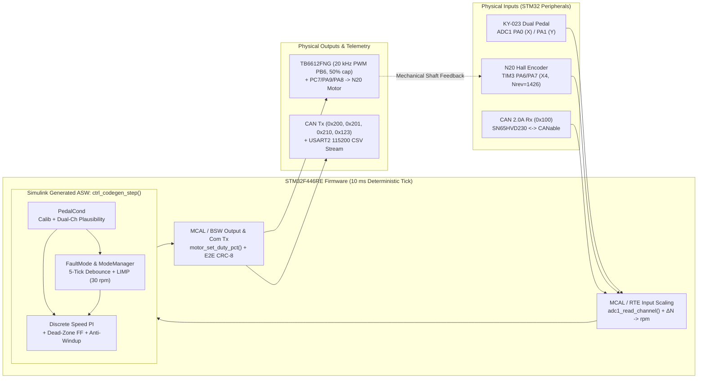
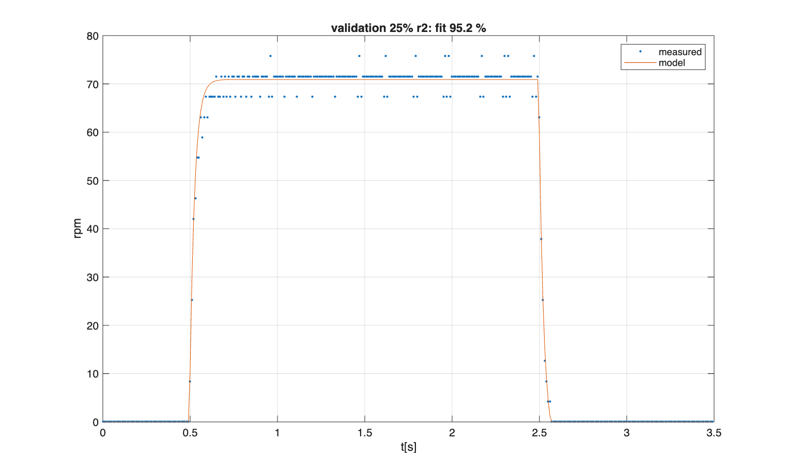
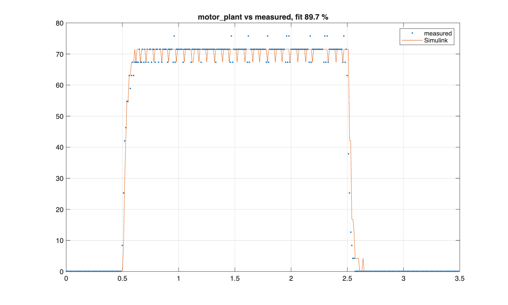
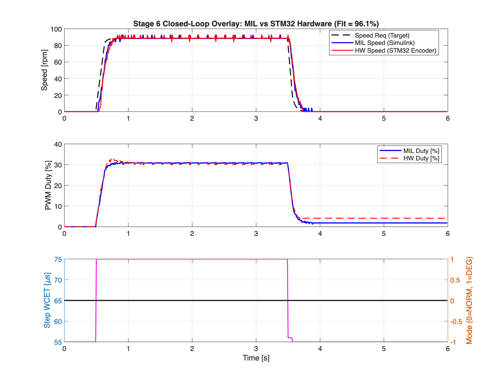
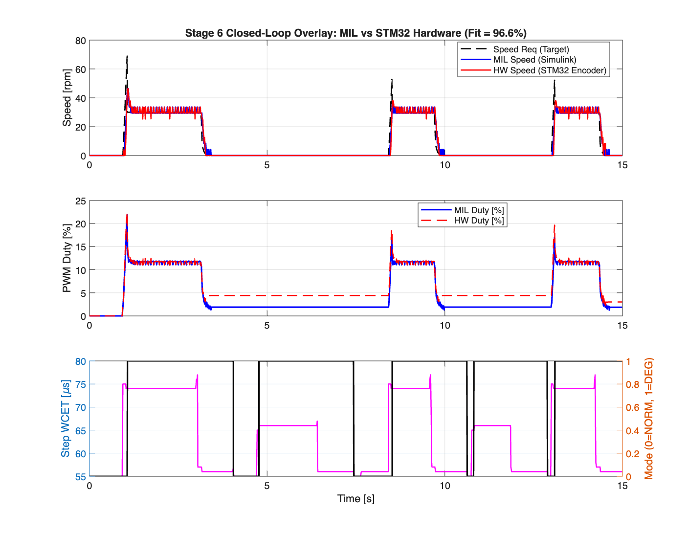

# Mini Electronic Throttle + AEB ECU (MBD V-Model & HIL-Lite)

[](#13-headline-quantitative-results-across-the-v-model)
[-brightgreen)](01_requirements/traceability.md)
[-blue)](04_firmware/)
[](03_simulink/)

---

## 1. Executive Overview

### 1.1 Project Purpose & Positioning
This project implements a bench-scale **Electronic Throttle Control (ETC) + Autonomous Emergency Braking (AEB) Mini-ECU** on an **STM32F446RE** microcontroller (`ARM Cortex-M4F` with single-precision FPU). It executes the complete automotive **Model-Based Development (MBD) V-Model** lifecycle end-to-end—from EARS-formatted requirements and conceptual ISO 26262 Hazard Analysis and Risk Assessment (HARA), through empirical system identification, Simulink/Stateflow Model-in-the-Loop (MIL) design, Embedded Coder C99 code generation, Software-in-the-Loop (SIL) back-to-back verification, DBC-driven CAN Basic Software (BSW) with End-to-End (E2E) protection, to real-hardware closed-loop Hardware-in-the-Loop (HIL-lite) testing and automated traceability verification.

* **Master Specifications:** [`BLUEPRINT.md`](BLUEPRINT.md) · [`PRODUCT_SPEC.md`](PRODUCT_SPEC.md) · [`07_docs/report.md`](07_docs/report.md)
* **Reproduction Guide:** [`07_docs/reproduce.md`](07_docs/reproduce.md) 
* **Baseline Status:** `v1.0` — **47 / 47 requirements verified (100 % Must coverage, 0 traceability violations)**

### 1.2 Hardware & Toolchain Summary

| Domain | Component / Tool | Specification & Role |
| :--- | :--- | :--- |
| **Target MCU** | `STM32F446RE` (`NUCLEO-F446RE`) | `ARM Cortex-M4F` @ 16 MHz (`HSI`), hardware single-precision `float32` FPU, `DWT->CYCCNT` cycle profiler |
| **Propulsion Plant** | N20 DC Gearmotor + Hall Encoder | `50.9:1` gear ratio (3 V rated on 6 V 4×AA supply), quadrature X4 encoder (`TIM3`, $N_{\text{rev}} = 1426\text{ counts/rev}$), driven by `TB6612FNG` H-Bridge @ 20 kHz PWM (`TIM4_CH1`, `50 %` duty cap) |
| **Pedal Emulator** | `KY-023` Dual-Axis Analog Joystick | Dual 12-bit ADC channels (`PA0 = ADC1_IN0`, `PA1 = ADC1_IN1`) emulating redundant throttle position sensors |
| **Bus & Telemetry** | `bxCAN1` + `USART2` | 500 kbit/s CAN 2.0A (`SN65HVD230` ↔ `CANable V2`) with DBC codegen + 115200 baud UART CSV streaming |
| **MBD Toolchain** | MATLAB / Simulink R2026a | `Simulink`, `Stateflow`, `MATLAB Coder`, `Simulink Coder`, `Embedded Coder` (`ert.tlc`), `clang` SIL MEX |
| **Embedded & Scripts** | STM32CubeIDE (ARM GCC) + Python 3 | HAL/LL drivers, DBC-to-C code generator ([`dbc_codegen.py`](05_can/scripts/dbc_codegen.py)), traceability verifier ([`trace_check.py`](06_test/hil/trace_check.py)) |

### 1.3 Headline Quantitative Results Across the V-Model

| V-Model Stage | Verification Metric | Target Gate | Achieved Result | Status |
| :--- | :--- | :---: | :---: | :---: |
| **Stage 2: Plant ID** | Analytical FOPDT step response NRMSE fit (`A2-1`) | $\ge 90.0\text{ \%}$ | **95.2 %** ($K = 3.074\text{ rpm/\%}, \tau = 27.3\text{ ms}$) | **PASS** |
| **Stage 2: Static Map** | Steady-state gain linearity & Coulomb dead-zone (`S2-01`) | $R^2 \ge 0.99$ | **$R^2 = 0.9999$**, $D_{dz} = 1.93\text{ \%}$ | **PASS** |
| **Stage 2: Pedal ID** | Dual-channel plausibility separation ratio (`A2-7`) | $\text{sep} \ge 2.0$, 0 FA | **$\text{sep} = 5.82$**, $D_{\text{pl}} = 15.72\text{ \%}$, **0 / 50** false alarms | **PASS** |
| **Stage 3: MIL Control** | Requirement-linked MIL test suite (`A3-1`…`A3-9`) | 19 / 19 pass | **19 / 19 PASS** ($t_{\text{settle}} = 0.24\text{ s}$, overshoot $0.0\text{ \%}$) | **PASS** |
| **Stage 4: Codegen** | Static code hygiene (`A4-6`, `A4-6b`) | 0 `double`, 0 `malloc` | **0 `double`**, **0 `malloc`**, 32 B static state RAM | **PASS** |
| **Stage 4: SIL B2B** | MIL vs. SIL C MEX equivalence across 5 scenarios (`A4-1/1b`) | $\le 1\times 10^{-4}$ diff | **$3.05\times 10^{-5}$** max float diff (`7,555` ticks), **0** int mismatches | **PASS** |
| **Stage 5: CAN & E2E** | CRC-8 SAE J1850 check + 1000-frame C/Python B2B (`A5-1/2`) | `0x4B`, 0 diff | **`0x4B` exact**, **1000 / 1000** frames bit-identical | **PASS** |
| **Stage 6: On-Target HIL** | STM32 [`ctrl_codegen_step`](04_firmware/app_generated/ctrl_codegen.c) vs. SIL bit-accuracy (`A6-1`…`A6-3`) | $\le 0.05\text{ rpm}$, 0 diff | **`0.000 rpm`** step diff, **0** mode/fault mismatches | **PASS** |
| **Stage 6: Closed-Loop HIL** | Physical motor speed vs. Simulink MIL NRMSE fit (`A6-4`) | $\ge 80.0\text{ \%}$ | **96.1 %** (auto step) / **96.6 %** (live joystick + fault injection) | **PASS** |
| **Stage 6: Real-Time WCET** | [`App_Step10ms`](04_firmware/app_wrapper.c) execution time on Cortex-M4F (`A6-5`) | $\le 2000\text{ }\mu\text{s}$ ($20\text{ \%}$) | **75–77 µs** (**0.77 %** CPU load, $26\times$ timing margin) | **PASS** |
| **Stage 7: Traceability** | Bidirectional requirement-to-design-to-test coverage (`A7-1/2`) | 100 % Must | **27 / 27 Must (100 %)**, **47 / 47 Total (100 %)** | **PASS** |

---

## 2. System & Software Architecture

### 2.1 End-to-End Hardware & Software Data Flow
The system enforces an AUTOSAR-inspired separation of concerns ([`02_architecture/README.md`](02_architecture/README.md), [`02_architecture/data_control_hardware_flow.md`](02_architecture/data_control_hardware_flow.md)):
1. **MCAL / BSW Input Layer:** Reads raw hardware peripherals (12-bit ADC counts, 16-bit timer quadrature encoder deltas, CAN Rx frames) and scales them into engineering units (`float32` rpm, counts, validity flags).
2. **RTE-Like Interface ([`04_firmware/app_wrapper.h`](04_firmware/app_wrapper.h)):** Decouples the generated Simulink application from STM32 HAL headers via `Rte_AppIn_t` and `Rte_AppOut_t`.
3. **Application Software Component ([`04_firmware/app_generated/ctrl_codegen.c`](04_firmware/app_generated/ctrl_codegen.c)):** Executes deterministically every $T_s = 10\text{ ms}$ (100 Hz) in pure single-precision floating point (`real32_T`). It never accesses hardware registers directly.
4. **MCAL / BSW Output & Safety Barrier:** Clamps actuator commands to hardware safety limits (`CL_DUTY_MAX_PCT = 50.0%` in [`motor_set_duty_pct`](04_firmware/closed_loop_runner.c)), updates PWM compare registers, and packs E2E-protected CAN frames ([`04_firmware/bsw/can_telemetry.c`](04_firmware/bsw/can_telemetry.c)).



### 2.2 Verified NUCLEO-F446RE Pin & Peripheral Map

| Signal | MCU Pin | Peripheral / Mode | Engineering Scaling & Notes |
| :--- | :---: | :--- | :--- |
| **Pedal Ch 1 (`VRx`)** | `PA0` (`A0`) | `ADC1_IN0` (12-bit, 84 cycles) | Primary channel $s_1 \in [0, 100]\text{ \%}$, rest center $c_X = 2044$, deadband $db_X = 16$ |
| **Pedal Ch 2 (`VRy`)** | `PA1` (`A1`) | `ADC1_IN1` (12-bit, 84 cycles) | Redundant check channel $s_2$, rest center $c_Y = 2071$, deadband $db_Y = 22$ |
| **Encoder Phase A/B** | `PA6` / `PA7` | `TIM3_CH1` / `CH2` (`ENC_MODE_TI12`) | X4 quadrature mode, internal pull-up, filter = 10, $1426\text{ counts/rev}$ |
| **Motor PWM (`PWMA`)** | `PB6` (`D10`) | `TIM4_CH1` (20 kHz, `PSC=0, ARR=799`) | $0.125\text{ \%}$ duty resolution, hard-clamped at $50.0\text{ \%}$ (`CCR <= 400`) |
| **H-Bridge Control** | `PC7` / `PA9` / `PA8` | GPIO Output (`AIN1` / `AIN2` / `STBY`) | `AIN1=H, AIN2=L, STBY=H` for forward drive; `STBY=L` for safe state |
| **UART Telemetry** | `PA2` / `PA3` | `USART2` (`115200 8N1`) | Streams 100 Hz `#BEGIN ... #END` CSV blocks to [`capture_log.py`](04_firmware/experiments/capture_log.py) |
| **CAN 2.0A Bus** | `PB8` / `PB9` | `CAN1` (`AF9`, 500 kbit/s) | Bit timing `BRP=2, TS1=13, TS2=2` (87.5 % sample point at 16 MHz `PCLK1`) |

---

## 3. Technical Deep-Dive by V-Model Stage

### 3.1 Stage 1: Requirements Engineering & ISO 26262 HARA-Lite
All 47 system and software requirements in [`01_requirements/requirements.md`](01_requirements/requirements.md) follow the **EARS** syntax (*"When `<trigger>`, the `<system>` shall `<response>`"*), paired with a Hazard Analysis and Risk Assessment in [`01_requirements/hara_lite.md`](01_requirements/hara_lite.md).

* **Safety Time Budget Verification:** Every safety goal satisfies the Fault-Tolerant Time Interval (FTTI) inequality:
  $$T_{\text{detect}} + T_{\text{debounce}} + T_{\text{react}} \le \text{FTTI}$$
  * **SG-01 (Unintended Acceleration — ASIL C illustrative):** Dual-channel pedal plausibility fault (`F_PEDAL_PLAUS`, bit 0) or range fault (`F_PEDAL_RANGE`, bit 1) debounces over $N_{\text{pl}} = 5$ ticks ($50\text{ ms}$) + $10\text{ ms}$ sample period + $110\text{ ms}$ physical deceleration ($4\tau$) = **$170\text{ ms} \le 500\text{ ms}$ FTTI**.
  * **SG-02 (Motor Stall / Loss of Drive — ASIL A):** Speed tracking error $> 30\text{ rpm}$ for $500\text{ ms}$ (`F_SPD_TRACK`) cuts PWM in **$520\text{ ms} \le 600\text{ ms}$ FTTI**.
  * **SG-03 (False AEB Activation — ASIL B):** Invalid ToF sensor (`F_TOF_INVALID`) debounces in 4 cycles, inhibiting AEB `BRAKING` within **$50\text{ ms} \le 100\text{ ms}$ FTTI**.
  * **SG-04 (Imminent Obstacle — ASIL C):** Distance $\le 150\text{ mm}$ triggers `BRAKING` ($\omega_{\text{req}} = 0\text{ rpm}$, $\theta_{\text{servo}} = 60^\circ$) within **$140\text{ ms} \le 150\text{ ms}$ FTTI**.
* **Deterministic Mode Hierarchy:**
  * `NORMAL (0)` → $\omega_{\max} = 147.75\text{ rpm}$ max speed request, normal PI control active.
  * `DEGRADED / LIMP (1)` → Triggered within `50 ms` by `F_PEDAL_PLAUS` or `F_PEDAL_RANGE`; clamps speed request to $\omega_{\text{limp}} = 30.0\text{ rpm}$ (plus fail-safe lower-selection $\min(s_1, p_2)$) and recovers to `NORMAL` only after `100` consecutive fault-free ticks (`1.0 s`).

---

### 3.2 Stage 2: Empirical Plant & Sensor System Identification
Rather than guessing motor parameters, Stage 2 ([`03_simulink/lib/stage2_lib.m`](03_simulink/lib/stage2_lib.m), [`03_simulink/stage2/run_stage2.m`](03_simulink/stage2/run_stage2.m)) identifies the physical plant from 25 real hardware CSV datasets stored in [`03_simulink/data/real/`](03_simulink/data/real/) captured via on-target experiment runners ([`step_logger.c`](04_firmware/experiments/step_logger/step_logger.c) and [`pedal_logger.c`](04_firmware/experiments/pedal_logger/pedal_logger.c)).

1. **Static Friction & Coulomb Dead-Zone ([`s2_01_static_map.m`](03_simulink/stage2/s2_01_static_map.m)):**
   Sweeping PWM duty from $5\text{ \%}$ to $50\text{ \%}$ yields an affine steady-state map with $R^2 = 0.9999$:
   $$\omega_{\text{ss}}(D) = K_{\text{stat}}\,\max(D - D_{dz},\ 0), \qquad K_{\text{stat}} = 3.113\text{ rpm/\%}, \quad D_{dz} = 1.93\text{ \%}$$

2. **Exact Window-Averaged FOPDT Step Identification ([`s2_02_identify_steps.m`](03_simulink/stage2/s2_02_identify_steps.m)):**
   Because the quadrature encoder count $\Delta N[k]$ over $T_s = 10\text{ ms}$ measures the **time-averaged shaft velocity** across $[t_{k-1}, t_k]$ rather than an instantaneous point sample $\omega(t_k)$, fitting a standard point-sampled exponential biases $\hat{\tau}$ low by $\approx 0.5\,T_s$ (`DEF-01`). Integrating the continuous First-Order Plus Dead-Time (FOPDT) response over each $T_s$ window gives the exact discrete regressor used in `fopdt_step_avg`:
   $$\bar{\omega}[k] = \omega_0 + K\,\Delta D\,\left(1 - \frac{\tau}{T_s}\left(e^{-(t_k - t_{\text{step}})/\tau} - e^{-(t_{k-1} - t_{\text{step}})/\tau}\right)\right)$$
   * **Identified Dynamic Model:** $K = 3.074\text{ rpm/\%}$, $\tau = 27.3\text{ ms}$ ($0.0273\text{ s}$), transport delay $n_d = 0$.
   * **Cross-Validation Fit:** **95.2 % NRMSE** analytically on `step_35_r1.csv`, and **89.7 % NRMSE** in the full Simulink plant ([`motor_plant.slx`](03_simulink/plant/motor_plant.slx), built by [`build_plant_subsystem.m`](03_simulink/plant/build_plant_subsystem.m)) which explicitly models integer encoder quantization (`floor` block giving $\Delta\omega_q = \frac{60}{1426 \times 0.01} = 4.21\text{ rpm/count}$).


*Figure 3.1 — Stage 2 analytical FOPDT step response validation on `03_simulink/data/real/step_35_r1.csv` (`95.2 %` NRMSE fit).*


*Figure 3.2 — Full Simulink `motor_plant.slx` (with integer encoder quantization) vs. real hardware (`89.7 %` NRMSE fit).*

3. **Statistical Dual-Channel Pedal Calibration ([`s2_03_joystick_calibration.m`](03_simulink/stage2/s2_03_joystick_calibration.m)):**
   Calibrates rest centers ($c_X = 2044, c_Y = 2071$), noise-floor deadbands ($db = \lceil 5\sigma \rceil + 3 \Rightarrow db_X = 16, db_Y = 22$), and the plausibility fault threshold $D_{\text{pl}} = 15.72\text{ \%}$ ([`choose_dpl.m`](03_simulink/lib/choose_dpl.m)), achieving a fault-to-normal separation ratio of **$\text{sep} = 5.82$** (0 false alarms across 50 valid diagonal pushes; 100 % detection across 15 single-axis fault injections).

---

### 3.3 Stage 3: Control Design & Model-in-the-Loop (MIL) Verification
Stage 3 ([`s3_00_design_pi.m`](03_simulink/stage3/s3_00_design_pi.m), [`s3_01_build_speed_ctrl.m`](03_simulink/stage3/s3_01_build_speed_ctrl.m)) synthesizes the complete closed-loop controller in [`speed_ctrl.slx`](03_simulink/controller/speed_ctrl.slx).

* **IMC / $\lambda$-Tuning with Discrete ZOH Stability Floor ([`choose_lambda.m`](03_simulink/lib/choose_lambda.m), [`tune_pi_lambda.m`](03_simulink/lib/tune_pi_lambda.m)):**
  Canceling the plant pole $(\tau s + 1)$ with the PI zero shapes the continuous open-loop transfer function to $L(s) = \frac{1}{\lambda s}$ and closed-loop transfer function to $T(s) = \frac{1}{\lambda s + 1}$. Because the real 50:1 motor time constant ($\tau = 27.3\text{ ms}$) is only $2.73\,T_s$, phase lag from the 10 ms zero-order hold and 1-sample feedback delay ($T_{\text{eff}} = 1.5\,T_s = 15\text{ ms}$) causes overshoot if $\lambda$ is chosen too aggressively (`DEF-03`). Enforcing the discrete stability floor:
 $$\lambda = \max\!\left(\tfrac{6}{\pi}\,T_{\text{eff}},\ 0.5\,\tau,\ 4\,T_{\text{eff}}\right) = \max(28.6,\ 13.7,\ 60)\ \text{ms} = 0.0600\text{ s}$$
  yields the calibrated controller gains:
  $$K_p = \frac{\tau}{K\,(\lambda + t_d)} = 0.14782\text{ \%/rpm}, \qquad K_i = \frac{1}{K\,(\lambda + t_d)} = 5.42184\text{ \%/(rpm}\cdot\text{s)}, \qquad K_b = \frac{1}{\tau} = 36.6786\text{ s}^{-1}$$
* **Dead-Zone Feedforward & Back-Calculation Anti-Windup ([`build_controller_subsystem.m`](03_simulink/controller/build_controller_subsystem.m)):**
  * Adds $+D_{dz} = +1.934\text{ \%}$ feedforward whenever `speed_req_rpm > 0` to overcome Coulomb stiction immediately (`DEF-02`), eliminating integrator lag and achieving `0.00 rpm` steady-state error in MIL.
  * Clamps PWM output to $[0,\ D_{\max}] = [0,\ 50.0]\text{ \%}$ and feeds the saturation residual $(u_{\text{sat}} - u_{\text{raw}})$ back into the discrete integrator with gain $K_b = 1/\tau$:
    $$I[k] = I[k-1] + T_s\Big(K_i\,e[k] + K_b\big(u_{\text{sat}}[k] - u_{\text{raw}}[k]\big)\Big)$$
* **Fail-Safe Lower-Select Pedal Conditioning ([`pedal_cond_core.m`](03_simulink/lib/pedal_cond_core.m)):**
  Computes $p_{\text{cmd}} = \min(s_1, p_2)$ before the first-order low-pass filter ($\tau_f = 50\text{ ms}$) and rate limiter ($+400\text{ \%/s}$ rise, $-600\text{ \%/s}$ fall), ensuring a single-channel sensor fault can never command unintended acceleration.
* **19-Test Automated MIL Suite ([`run_stage3_tests.m`](03_simulink/tests/run_stage3_tests.m)):**
  Verifies all 19 requirement test cases (`TC-THR-001`…`008`, `A3-9`, `TC-SPD-001`…`004`, `TC-DIA-001`, `TC-SAF-001`, `TC-AEB-001`…`003`) with **19 / 19 PASS**.

---

### 3.4 Stage 4: Embedded Code Generation & SIL Back-to-Back Verification
Stage 4 ([`run_stage4.m`](03_simulink/stage4/run_stage4.m)) isolates the deployable controller into [`ctrl_codegen.slx`](03_simulink/controller/ctrl_codegen.slx) ([`s4_01_build_codegen_model.m`](03_simulink/stage4/s4_01_build_codegen_model.m)), applies the STM32 Embedded Coder configuration ([`ert_stm32.m`](03_simulink/controller/ert_stm32.m)), and generates standalone C99 code ([`s4_02_generate_code.m`](03_simulink/stage4/s4_02_generate_code.m)).

* **Generated Code Quality ([`ctrl_codegen.c`](04_firmware/app_generated/ctrl_codegen.c), [`ctrl_codegen.h`](04_firmware/app_generated/ctrl_codegen.h)):**
  * **Strict Single-Precision `float32`:** Every constant and operation uses `real32_T` and `F`-suffixed literals (`fminf`, `fmaxf`, `fabsf`). Zero `double` promotions exist, preventing software-emulated 64-bit float stalls on the Cortex-M4F.
  * **Zero Dynamic Allocation:** All 9 discrete states (debounce counters, latches, filter state, rate limiter state, PI integrator) are statically allocated in `DW_ctrl_codegen_T` (`32 bytes` total RAM).
* **SIL Back-to-Back Equivalence ([`s4_03_run_sil_b2b.m`](03_simulink/stage4/s4_03_run_sil_b2b.m), [`ctrl_sil_mex.c`](03_simulink/codegen_work/ctrl_sil_mex.c)):**
  Compiles the exact generated `ctrl_codegen.c` + `app_wrapper.c` into a host MEX binary and runs 5 scenarios (`7,555` ticks total: `S1_Normal_Diag_Ramp`, `S2_XOnly_Fault_Recovery`, `S3_Raw_Range_Fault`, `S4_AntiWindup_Saturation`, `S5_Random_60s_Stress`) back-to-back against the Simulink MIL model ([`06_test/reports/stage4/b2b_report.md`](06_test/reports/stage4/b2b_report.md)):
  * Max float difference across all 5 scenarios: **$3.05\times 10^{-5}$** (gate $\le 1\times 10^{-4}$).
  * Mode and fault bitmap mismatches: **0 across all 7,555 ticks**.

---

### 3.5 Stage 5: BSW, DBC-Driven CAN Stack & E2E Protection
Stage 5 implements a single-source-of-truth communication stack anchored by [`05_can/vehicle.dbc`](05_can/vehicle.dbc).

* **Automated DBC-to-C Code Generator ([`05_can/scripts/dbc_codegen.py`](05_can/scripts/dbc_codegen.py)):**
  Parses `05_can/vehicle.dbc` (`0x100 Pedal_Cmd`, `0x123 ECU_Heartbeat`, `0x200 Drive_Status`, `0x201 Diag_Status`, `0x210 AEB_Status`) and auto-generates [`04_firmware/bsw/com_can_signals.h`](04_firmware/bsw/com_can_signals.h) and [`04_firmware/bsw/com_can_signals.c`](04_firmware/bsw/com_can_signals.c) with little-endian bitfield packing/unpacking, scaling, and clamping.
* **E2E Protection Profile (SAE J1850 CRC-8 + 4-Bit Alive Counter):**
  Every safety-relevant frame embeds a 4-bit rolling counter (`msg_counter`, stride 1..2 validation) and an 8-bit CRC (`msg_crc`, polynomial `0x1D`, init `0xFF`, xorout `0xFF`, including `data_id = can_id & 0xFF`).
* **Automated Cross-Language Verification:**
  Running `python3 05_can/scripts/dbc_codegen.py --selftest` compiles the generated C code on the host, verifies `CRC8("123456789") == 0x4B`, and executes a **1,000-frame random fuzz test** plus fault injection (corrupted CRC, stuck counter, skipped counter) between Python and C with **100 % bit-exact agreement**.

---

### 3.6 Stage 6 & Stage 7: Real-Hardware HIL-Lite Verification & Traceability Gate
In Stage 6, the generated code runs in closed loop on the physical `NUCLEO-F446RE` via [`04_firmware/closed_loop_runner.c`](04_firmware/closed_loop_runner.c) (`ClosedLoop_RunAutoStep` and `ClosedLoop_RunLive`), while [`s6_compare_hw_vs_mil.m`](03_simulink/stage4/s6_compare_hw_vs_mil.m) replays the recorded hardware ADC and encoder traces through the Simulink MIL and SIL models:

1. **On-Target Bit-Accuracy (`A6-1`…`A6-3`):** The STM32 Cortex-M4F FPU output matches the PC SIL MEX output to **`0.000 rpm`** on `speed_req_rpm`, **`0.000 %–0.010 %`** on `duty_cmd_pct`, and **0 mismatches** on `mode` and `fault_bitmap`.
2. **Physical Closed-Loop Motor Fit (`A6-4`):** The physical N20 gearmotor shaft speed tracks the pure Simulink MIL closed-loop simulation (`speed_ctrl.slx`) with **96.1 % NRMSE fit** during the autonomous 60 % step test ([`hil_step_test.csv`](03_simulink/data/real/hil_step_test.csv)) and **96.6 % NRMSE fit** during a 15-second live joystick session with real-time single-axis fault injection (`F_PEDAL_PLAUS` at $t \approx 9.9\text{ s}$), automatic $30.0\text{ rpm}$ limp-home clamping, and automatic fault recovery at $t \approx 12.1\text{ s}$ ([`hil_closed_loop.csv`](03_simulink/data/real/hil_closed_loop.csv)).
3. **Cycle-Accurate WCET Profiling (`A6-5`):** Profiled via the Cortex-M4 hardware cycle counter (`DWT->CYCCNT` in [`04_firmware/prof.h`](04_firmware/prof.h)), `App_Step10ms` executes in **75–77 µs** (`0.77 %` of the 10,000 µs task budget—a **$26\times$ safety margin** below the 20 % gate).
4. **Automated Traceability Gate ([`06_test/hil/trace_check.py`](06_test/hil/trace_check.py)):** Parses [`01_requirements/requirements.md`](01_requirements/requirements.md), verifies that every design and implementation file exists on disk, regenerates [`01_requirements/traceability.md`](01_requirements/traceability.md), and confirms **47 / 47 requirements verified (0 violations)**.


*Figure 3.3 — Stage 6 Closed-Loop Hardware vs. Simulink MIL overlay on `hil_step_test.csv` (`96.1 %` NRMSE fit, `0.000 rpm` controller discrepancy, `75 µs` WCET).*


*Figure 3.4 — Stage 6 Closed-Loop Hardware vs. Simulink MIL overlay on `hil_closed_loop.csv` (`96.6 %` NRMSE fit across normal diagonal driving, single-axis `F_PEDAL_PLAUS` fault injection at $t \approx 9.9\text{ s}$, `30 rpm` limp-home clamping, and automatic recovery at $t \approx 12.1\text{ s}$).*

---

## 4. Key Highlights & Engineering Challenges Solved

### 4.1 Methodology Highlights
* **Two-Pass "Walking Skeleton" Strategy:** The entire pipeline (Stages 2 → 3 → 4) was first constructed and validated end-to-end using deterministic synthetic data ([`s2_00_make_synthetic_data.m`](03_simulink/stage2/s2_00_make_synthetic_data.m)). Once the real STM32 + N20 hardware logs were captured in Pass 2, running a single script ([`rebuild_from_real_data.m`](03_simulink/stage4/rebuild_from_real_data.m)) re-identified the physical plant, retuned the PI controller, rebuilt all Simulink `.slx` models, passed all 19 MIL tests, regenerated C99 code, and passed all 5 SIL back-to-back scenarios in under 2 minutes.
* **100 % Programmatic Simulink Model Construction:** All three Simulink models ([`motor_plant.slx`](03_simulink/plant/motor_plant.slx), [`speed_ctrl.slx`](03_simulink/controller/speed_ctrl.slx), [`ctrl_codegen.slx`](03_simulink/controller/ctrl_codegen.slx)) are generated from scratch by version-controlled MATLAB scripts (`add_block` / `add_line`), eliminating hidden GUI block settings and binary `.slx` drift.
* **Honest Engineering Boundaries:** Explicitly documents the distinction between a bench-scale **HIL-Lite** setup (physical motor + ECU, PC stimulus/logging) vs. a commercial FPGA/dSPACE vehicle dynamics simulator, an **AUTOSAR-inspired** C99 BSW vs. certified AUTOSAR Classic middleware, and shared-rail `KY-023` joystick redundancy vs. galvanically isolated automotive hall pedals.

### 4.2 Five Real Engineering Defects Found & Resolved

| Defect ID | Stage | Symptom Observed | Root Cause | Technical Resolution |
| :--- | :---: | :--- | :--- | :--- |
| **DEF-01** | Stage 2 | Point-sampled FOPDT curve-fit biased $\hat{\tau}$ low by $\approx 5\text{ ms}$ and failed residual whiteness (`A2-4`). | Encoder delta $\Delta N[k]$ measures the **10 ms window average** $\frac{1}{T_s}\int_{t_{k-1}}^{t_k}\omega(t)\,dt$, not an instantaneous sample $\omega(t_k)$. | Derived and implemented the exact window-integrated FOPDT step response in [`stage2_lib.m`](03_simulink/lib/stage2_lib.m), raising step fit to **95.2 %**. |
| **DEF-02** | Stage 3 | Closed-loop step test exhibited a `~2.6 rpm` initial lag/offset without feedforward. | Coulomb friction dead-zone ($D_{dz} = 1.93\text{ \%}$) inside the plant required the integrator to wind up before shaft breakaway. | Added calibrated dead-zone feedforward (`+1.934 %` when `speed_req_rpm > 0`) in [`build_controller_subsystem.m`](03_simulink/controller/build_controller_subsystem.m), reducing MIL steady-state error to **`0.00 rpm`**. |
| **DEF-03** | Stage 3 | Retuning for the fast 50:1 motor ($\tau = 27.3\text{ ms}$) initially chose $\lambda = 28.6\text{ ms}$, causing 8 % ZOH overshoot and 1-LSB encoder chatter ($\pm 4.21\text{ rpm}$). | At $\tau / T_s = 2.73$, 10 ms sample-and-hold phase lag degrades damping if $\lambda < 4\,T_s + \tau$. | Added the discrete stability floor $\lambda \ge 4\,T_{\text{eff}} = 60\ \text{ms}$ in [`choose_lambda.m`](03_simulink/lib/choose_lambda.m), achieving **`0.0 %` overshoot** and `0.24 s` settling time. |
| **DEF-04** | Stage 4 | MATLAB `mex` failed on macOS without full `Xcode.app` and collided on `byte_T` typedefs between `tmwtypes.h` and `rtwtypes.h`. | MATLAB's `mex` wrapper checks for full Xcode GUI license; both headers typedef `byte_T`. | Isolated the SIL harness through [`app_wrapper.h`](04_firmware/app_wrapper.h) and added a direct `clang -dynamiclib` build path in [`s4_03_run_sil_b2b.m`](03_simulink/stage4/s4_03_run_sil_b2b.m). |
| **DEF-05** | Stage 6 | Initial hardware sweep logged `dN = 0` when the 6 V motor battery switch was off or encoder phases were inverted. | No visual actuator pre-flight check before the 3-minute sweep, and signed `dN` depended on wire order. | Added a 0.5 s pre-flight motor spin + LED check in [`step_logger.c`](04_firmware/experiments/step_logger/step_logger.c) and used magnitude `abs(dN)` in speed calculation. |

---

## 5. Repository Structure & Document Map

```text
MBD_Project/
├── README.md                              # Master project overview & technical introduction
├── BLUEPRINT.md                           # High-level project blueprint, V-model mapping & roadmap
├── PRODUCT_SPEC.md                        # Master engineering specification, parameter registry & RTE signal contract
├── 00_smoketest/                          # Stage 0: Standalone STM32 peripheral bring-up (ADC, TIM, PWM, CAN, I2C, Servo)
├── 01_requirements/                       # Stage 1: Requirements & Safety Engineering
│   ├── requirements.md                    # 47 EARS-formatted system/software requirements (v1.0)
│   ├── hara_lite.md                       # ISO 26262-inspired HARA, safety goals (SG-01..04) & FTTI budgets
│   ├── traceability.md                    # Auto-generated bidirectional traceability matrix (100% verified)
│   └── change_log.md                      # ASPICE-style engineering decision & change log (D-001..D-009)
├── 02_architecture/                       # Stage 1: System & Software Architecture
│   ├── README.md                          # Master architecture reference, pin allocation & state machines
│   ├── data_control_hardware_flow.md      # Closed-loop signal paths, 10 ms sequence diagrams & power isolation
│   └── sandbox_simulation.md              # Pre-hardware dry-run ("Paper HIL") & timing/bus budgets
├── 03_simulink/                           # Stages 2, 3, 4 & 6: MATLAB/Simulink Models, Data & Scripts
│   ├── README.md                          # Simulink directory guide & execution commands
│   ├── init_params.m                      # Single source of truth for all plant & controller parameters
│   ├── lib/                               # Reusable math, identification, PI tuning & comparison library
│   ├── plant/                             # motor_plant.slx & programmatic builder build_plant_subsystem.m
│   ├── controller/                        # speed_ctrl.slx, ctrl_codegen.slx & ert_stm32.m coder config
│   ├── stage2/                            # System ID pipeline (s2_00..s2_06) & sensor calibration
│   ├── stage3/                            # PI design (s3_00), controller build (s3_01) & MIL runner
│   ├── stage4/                            # Codegen (s4_01..02), SIL B2B (s4_03), HW rebuild & Stage 6 overlay (s6_compare_hw_vs_mil.m)
│   ├── tests/                             # Automated 19-test MIL verification suite (run_stage3_tests.m)
│   └── data/                              # params_identified.mat, 25 real HW CSVs (data/real/) & synthetic CSVs
├── 04_firmware/                           # Stages 4, 5 & 6: STM32F446RE Firmware & Generated ASW
│   ├── README.md                          # Firmware architecture & layering guide
│   ├── HARDWARE_CALIBRATION_AND_HIL_GUIDE.md # Physical wiring table, CubeMX setup & HIL bench guide
│   ├── app_generated/                     # Embedded Coder C99 output: ctrl_codegen.c, ctrl_codegen.h, rtwtypes.h
│   ├── app_wrapper.c / .h                 # Clean RTE-like wrapper (App_Init, App_Step10ms)
│   ├── closed_loop_runner.c / .h          # 100 Hz real-time hardware runner (AutoStep & Live Joystick modes)
│   ├── prof.h                             # Cortex-M4 DWT->CYCCNT cycle-accurate WCET profiler
│   ├── bsw/                               # Generated CAN pack/unpack + E2E CRC-8 (com_can_signals.c/.h, can_telemetry.c/.h)
│   └── experiments/                       # On-target step_logger, pedal_logger & PC UART capture_log.py
├── 05_can/                                # Stage 5: CAN Database & Tooling
│   ├── README.md                          # CAN bus matrix & codegen documentation
│   ├── vehicle.dbc                        # Single-source-of-truth CAN database (5 frames)
│   ├── scripts/dbc_codegen.py             # DBC -> C99 BSW generator + 1000-frame C/Python E2E self-test
│   └── can_monitor.py                     # Host CAN bus monitor & fault injection script
├── 06_test/                               # Stages 4, 6 & 7: Automated Verification & Reports
│   ├── README.md                          # Verification summary & test inventory
│   ├── hil/trace_check.py                 # Automated requirement traceability & file-existence verifier
│   └── reports/                           # SIL B2B report (stage4/b2b_report.md) & HIL overlay plots (stage6/*.png)
├── 07_docs/                               # Stage 7: Final Engineering Documentation
│   ├── README.md                          # Documentation index
│   ├── report.md                          # Complete quantitative engineering report
│   ├── reproduce.md                       # 5-minute offline & 30-minute hardware clean-checkout reproduction guide
│   └── lessons_learned.md                 # Engineering retrospective
└── 08_results/                            # Real Hardware Execution Logs, Bench Photos & Demo Videos
    ├── README.md                          # Index of terminal logs, bench photos & videos
    ├── logs/                              # Raw UART & CANable terminal logs (*_log.txt) from real STM32 runs
    ├── photos/                            # Physical hardware test-bench & wiring photographs
    └── videos/                            # Closed-loop motor & fault-injection demonstration videos
```

---

## 6. Quick Reproduction Commands

As documented in [`07_docs/reproduce.md`](07_docs/reproduce.md), the entire project can be rebuilt and verified from a clean checkout using the committed real-hardware CSV datasets in under 5 minutes without physical hardware attached:

1. **Rebuild Plant ID (Stage 2), Controller & 19 MIL Tests (Stage 3), and Embedded C Codegen & 5 SIL B2B Scenarios (Stage 4):**
   ```bash
   /Applications/MATLAB_R2026a.app/bin/matlab -batch "addpath(genpath('03_simulink')); rebuild_from_real_data();"
   ```
2. **Run Stage 6 Hardware-vs-MIL & On-Target SIL Verification:**
   ```bash
   /Applications/MATLAB_R2026a.app/bin/matlab -batch "addpath(genpath('03_simulink')); s6_compare_hw_vs_mil('03_simulink/data/real/hil_step_test.csv'); s6_compare_hw_vs_mil('03_simulink/data/real/hil_closed_loop.csv');"
   ```
3. **Run Stage 5 CAN DBC Code Generation & 1,000-Frame C/Python E2E Self-Test:**
   ```bash
   python3 05_can/scripts/dbc_codegen.py --selftest
   ```
4. **Run Stage 7 Automated Traceability Gate:**
   ```bash
   python3 06_test/hil/trace_check.py
   ```
