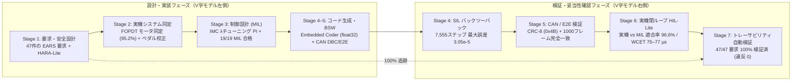
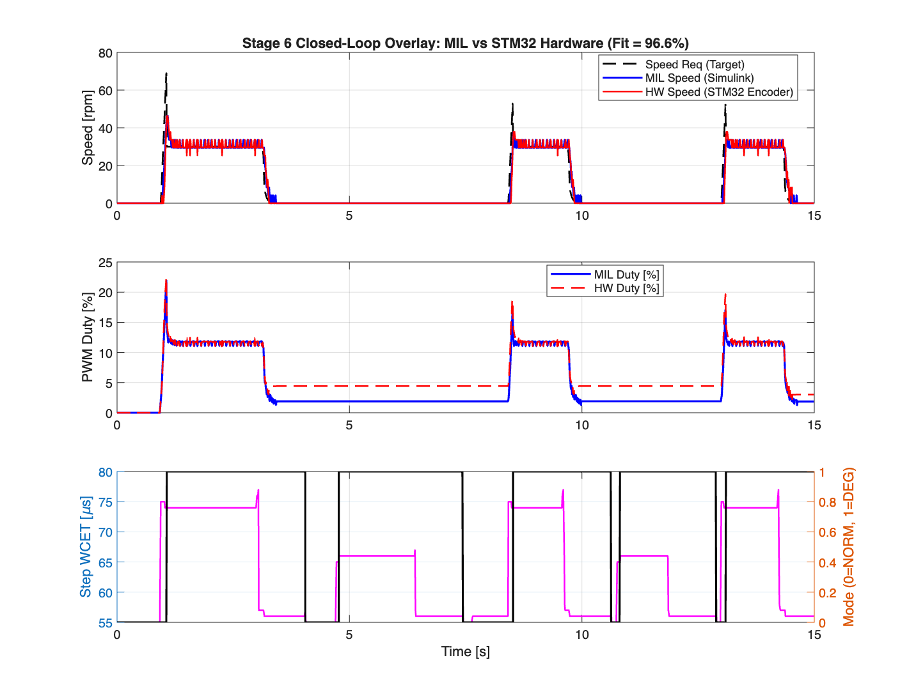

# 車載 MBD（モデルベース開発）＆ HIL-Lite ECU プロジェクト（電子スロットル制御 + AEB）

> **English Documentation:** [`README.md`](README.md) ｜ **詳細技術レポート:** [`07_docs/report.md`](07_docs/report.md) ｜ **再現手順:** [`07_docs/reproduce.md`](07_docs/reproduce.md)

---

## 1. プロジェクト概要

本プロジェクトは、車載組込み開発における **V字モデル（MBD：モデルベース開発）** の全工程を、実機マイコン（**STM32F446RE / ARM Cortex-M4F**）および実機 DC ギヤードモータを用いて一貫実装・検証した **小型電子スロットル制御（ETC）＋自動緊急ブレーキ（AEB）ECU** です。

要求分析（EARS 記法・簡易機能安全 HARA）から、実機計測データに基づくプラント同定、Simulink/Stateflow による制御設計（MIL）、Embedded Coder による単精度 C99 自動コード生成と等価性検証（SIL）、DBC 駆動の CAN 通信・E2E 保護（BSW）、実機閉ループ試験（HIL-Lite）、および双方向トレーサビリティ自動検証までをエンドツーエンドで構築しています。



---

## 2. 開発環境・ハードウェア構成

| 分野 | 使用機材・ツール | 主な仕様・役割 |
| :--- | :--- | :--- |
| **ターゲット ECU** | `STM32F446RE` (`NUCLEO-F446RE`) | `ARM Cortex-M4F` @ 16 MHz、単精度 FPU、`DWT->CYCCNT` サイクル計測 |
| **駆動プラント** | N20 DC ギヤードモータ + ホールエンコーダ | 減速比 `50.9:1`（3 V 定格 / 6 V 電源）、X4 逓倍（`1426 counts/rev`）、`TB6612FNG`（20 kHz PWM、デューティ上限 `50 %`） |
| **アクセル模擬** | `KY-023` 2軸アナログジョイスティック | 12-bit ADC 2系統（`PA0` / `PA1`）による冗長ペダルセンサ模擬・整合性監視 |
| **車載通信** | `bxCAN1` + `CANable V2` / `USART2` | 500 kbit/s CAN 2.0A（`SN65HVD230`、DBC 自動生成 + E2E CRC-8）＋ UART CSV ロギング |
| **MBD ツール** | MATLAB / Simulink R2026a | `Simulink`, `Stateflow`, `Embedded Coder` (`ert.tlc`), `clang` SIL MEX |
| **組込み・スクリプト** | STM32CubeIDE (ARM GCC) / Python 3 | HAL/LL ドライバ、DBC→C コード生成器（[`dbc_codegen.py`](05_can/scripts/dbc_codegen.py)）、トレーサビリティ検証（[`trace_check.py`](06_test/hil/trace_check.py)） |

---

## 3. 主要な検証結果（V字モデル各工程）

| 工程 | 検証項目 | 合格基準 | 実測結果 | 判定 |
| :--- | :--- | :---: | :---: | :---: |
| **Stage 2: プラント同定** | 実機ステップ応答 FOPDT モデル適合率 | `>= 90.0 %` | **95.2 %**（$K = 3.074\text{ rpm/\%}, \tau = 27.3\text{ ms}$） | **PASS** |
| **Stage 2: センサ校正** | 2系統ペダル異常分離比（誤検知ゼロ） | `sep >= 2.0`, 誤検知 `0` | **sep = 5.82**（閾値 `15.72 %`、誤検知 `0 / 50`） | **PASS** |
| **Stage 3: MIL 検証** | 要求紐付け MIL 自動テストスイート | `19 / 19` 合格 | **19 / 19 PASS**（整定時間 `0.24 s`、オーバーシュート `0.0 %`） | **PASS** |
| **Stage 4: コード品質** | 生成 C99 コード静的検査 | `double` 0件 / `malloc` 0件 | **double 0件**、**malloc 0件**、静的 RAM **32 bytes** | **PASS** |
| **Stage 4: SIL 等価性** | MIL vs SIL (C MEX) バックツーバック | 浮動小数点差 `<= 1e-4` | 最大誤差 **$3.05\times 10^{-5}$**（`7,555` ステップ、状態不一致 `0`） | **PASS** |
| **Stage 5: CAN / E2E** | SAE J1850 CRC-8 ＋ 1,000フレーム比較 | `0x4B` / 差異 `0` | **`0x4B` 一致**、**1,000 / 1,000** フレーム完全一致 | **PASS** |
| **Stage 6: 実機 HIL** | 実機モータ速度 vs Simulink MIL 適合率 | `>= 80.0 %` | **96.1 %**（自動ステップ）/ **96.6 %**（手動操作＋故障注入） | **PASS** |
| **Stage 6: 実機処理時間** | `App_Step10ms` 最悪実行時間（WCET） | `<= 2000 µs` (`20 %`) | **75–77 µs**（CPU 負荷率 **0.77 %**、10 ms 周期） | **PASS** |
| **Stage 7: トレーサビリティ** | 要求・設計・実装・テスト双方向網羅率 | `Must` 100 % | **27 / 27 Must (100 %)**、**47 / 47 全体 (100 %)** | **PASS** |


*図：実機 STM32F446RE 閉ループ計測結果と Simulink MIL シミュレーションの比較（適合率 `96.6 %`。$t \approx 9.9\text{ s}$ にて片軸故障 `F_PEDAL_PLAUS` を注入し、`30 rpm` リンプホーム制限へ移行後、$t \approx 12.1\text{ s}$ で自動復帰）*

---

## 4. ディレクトリ構成

| フォルダ / ファイル | 工程 | 内容 |
| :--- | :---: | :--- |
| [`00_smoketest/`](00_smoketest/) | Stage 0 | STM32 周辺ペリフェラル単体動作確認（ADC, エンコーダ, PWM, CAN, サーボ, I2C） |
| [`01_requirements/`](01_requirements/) | Stage 1 | 47件の EARS 要求仕様（[`requirements.md`](01_requirements/requirements.md)）、HARA-Lite、自動生成トレーサビリティ表 |
| [`02_architecture/`](02_architecture/) | Stage 1 | AUTOSAR 風レイヤ構造・ピン配置・10 ms 周期タスクシーケンス |
| [`03_simulink/`](03_simulink/) | Stage 2–4 | スクリプト自動生成 Simulink モデル（`.slx`）、実機 CSV データ（25件）、MIL テスト |
| [`04_firmware/`](04_firmware/) | Stage 4–6 | Embedded Coder 生成コード（[`ctrl_codegen.c`](04_firmware/app_generated/ctrl_codegen.c)）、RTE ラッパ、CAN BSW |
| [`05_can/`](05_can/) | Stage 5 | CAN データベース（[`vehicle.dbc`](05_can/vehicle.dbc)）、DBC→C 自動生成ツール、CAN モニタ |
| [`06_test/`](06_test/) | Stage 4–7 | SIL 等価性レポート、Stage 6 実機比較プロット、トレーサビリティ自動検証スクリプト |
| [`07_docs/`](07_docs/) | Stage 7 | 詳細技術レポート（[`report.md`](07_docs/report.md)）、クリーン環境再現手順（[`reproduce.md`](07_docs/reproduce.md)） |
| [`08_results/`](08_results/) | 実機証跡 | 実機 UART / CANable 動作ログ（[`logs/`](08_results/logs/)）、実験ベンチ写真・動画 |

---

## 5. クイック検証コマンド（再現手順）

実機が手元にない環境でも、リポジトリ内の実機ログを用いて以下を実行できます（詳細は [`07_docs/reproduce.md`](07_docs/reproduce.md) を参照）：

```bash
# 1. Stage 5: CAN DBC コード生成 ＋ E2E CRC-8 1,000フレーム自己検証
python3 05_can/scripts/dbc_codegen.py --selftest

# 2. Stage 7: 要求トレーサビリティ自動検証ゲート
python3 06_test/hil/trace_check.py

# 3. Stage 2–4: 実機データからのモデル再同定・19件 MIL テスト・Cコード生成・SIL 検証（MATLAB）
/Applications/MATLAB_R2026a.app/bin/matlab -batch "addpath(genpath('03_simulink')); rebuild_from_real_data();"
```
